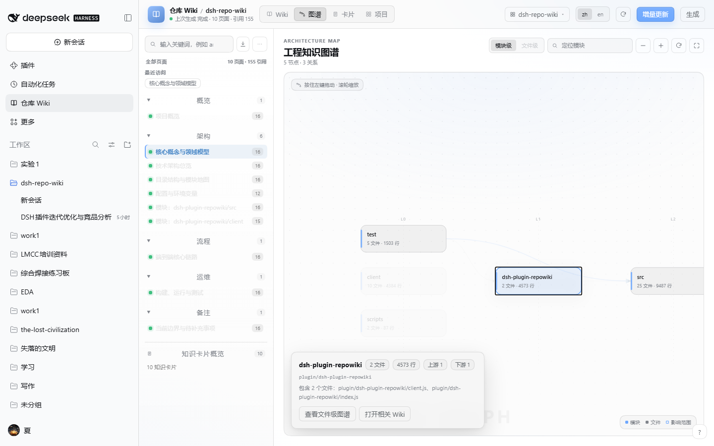
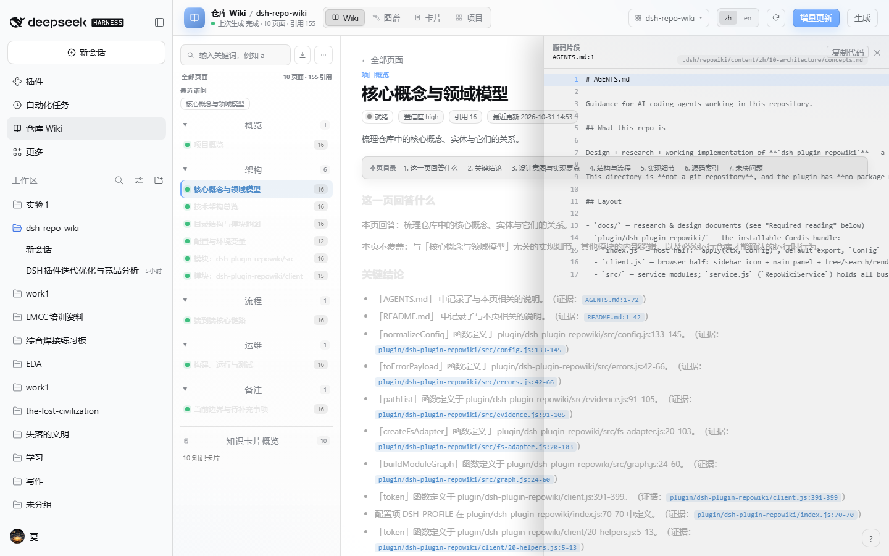

# CodeMap · dsh-plugin-codemap

> 把一个代码仓库编译成**带源码行号引用**的代码地图 —— 给 AI 编程助手用，也给人类读者用。

[](https://www.npmjs.com/package/dsh-plugin-codemap)
[](./LICENSE)


**CodeMap** 是 [DeepSeek Harness](https://github.com/deepseek-ai) 的一个插件：它扫描仓库、建立模块/符号/路由索引，自动规划并生成一组**结构化代码地图页面**，每一条结论都带 `path:line` 形式的源码引用；同时提供交互式**工程知识图谱**、**知识卡片**和一组**模型工具**。

整个生成过程**不调用任何模型**：证据由代码算出、引用逐条校验，因此离线可跑、结果可复算、不会凭空编造。


| 概览 | 知识图谱 | 源码跳转 |
|---|---|---|
|  |  |  |

---

## 目录

- [为什么需要它](#为什么需要它)
- [能力一览](#能力一览)
- [安装](#安装)
- [使用](#使用)
- [产物](#产物)
- [安全边界](#安全边界)
- [本地开发](#本地开发)
- [兼容性](#兼容性)
- [文档](#文档)
- [English](#english)
- [License](#license)

---

## 为什么需要它

AI 编程助手进入一个陌生仓库时，最贵的两件事是**读源码**和**理解结构**。CodeMap 把这两件事做成了可复用的资产：

| 痛点 | CodeMap 的做法 |
|---|---|
| 模型对仓库结构没有稳定认知 | 规划出固定的页面结构（概览/架构/流程/运维/边界），并为显著模块生成详情页 |
| 模型容易编造 API 与行为 | 每条结论都带 `path:line`，生成后逐条回查真实文件与行号，校验失败即标记 `needs-review` |
| 文档写完就过期 | 页面记录输入哈希，源码变了能定位到"哪些页面该重写" |
| 只能读文字，看不见结构 | 侧栏面板提供可拖拽的模块依赖图谱，点节点可下钻文件级、看影响范围、跳到源码 |
| 调用模型贵、离线不可用 | 零模型调用、零第三方依赖，`npm run check` 3 秒内跑完全部回归 |

## 能力一览

**模型工具**（模型可主动调用）

| 工具 | 作用 |
|---|---|
| `codemap_search` | 在已生成的代码地图中做中英文混合检索，返回带片段的命中列表 |
| `codemap_read` | 读取某页完整 Markdown（含 frontmatter 与引用），支持扁平 id 与分节 id |
| `codemap_generate` | 生成/增量刷新代码地图（自动规划 → 收集证据 → 渲染 → 校验引用） |
| `codemap_status` | 报告页面数、上次运行是否完整、面板入口状态，不触发生成 |

**斜杠命令**：`/codemap status | plan | generate | update | export | import | help`

**侧栏面板**：左侧栏图标 → 中央面板，提供页面树、搜索（状态过滤 + 高亮）、知识图谱（拖拽/缩放/下钻）、知识卡片库、引用点击直达源码片段。

**产物**：`.<repo>/.dsh/codemap/`，纯 Markdown + JSON，可 diff、可手改、可随 Git 共享；还能一键导出成 `.qoder/repowiki` 与 Qoder 互操作。

## 安装

### 方式一：DeepSeek Harness 插件社区（推荐）

1. 打开 Harness → 插件市场（Plugin Market）
2. 搜索 `codemap`（或 `dsh-plugin-codemap`）
3. 点击安装 → Harness 自动从 npm 拉取并注册

### 方式二：npm 直接安装

```bash
npm install -g dsh-plugin-codemap
```

### 方式三：本地开发（link）

```bash
git clone https://github.com/cheng200606/dsh-plugin-codemap.git
cd dsh-plugin-codemap
npm install          # 无运行时依赖，这一步只为建立 link
```

在 Harness 的 profile 目录（`~/.dsh/profiles/<profile>/`）里：

```jsonc
// package.json
{
  "dependencies": {
    "dsh-plugin-codemap": "link:/绝对路径/dsh-plugin-codemap"
  },
  "dsh": { "profile": { "bundles": ["dsh-plugin-codemap"] } }
}
```

然后 `pnpm install`，并在插件管理里把 `dsh-plugin-codemap` 设为启用。

> 改完浏览器半体（`client/*.js`）后需要 `npm run build` 重新生成 `client.js`，再重载 Harness。

## 使用

**在 Harness 里**

```
/codemap generate          # 为当前仓库生成代码地图
/codemap status            # 查看页面数与上次运行状态
```

**让模型用它**：直接问"这个仓库的鉴权流程是怎样的"，模型会自动调用 `codemap_search` / `codemap_read`；必要时用 `codemap_generate` 现场构建。

**产物长什么样**

```markdown
---
id: architecture
title: "技术架构总览"
status: fresh
confidence: high
---

## 关键结论
- 「buildRepositoryProfile」函数定义于 src/service.js:421-441。（证据：`src/service.js:421-441`）

## 设计意图与实现要点
- `src/service.js` 属于「服务层」相关实现：关键符号包括 buildRepositoryProfile、resolveRequestRoot；
  被 src/routes.js 引用。`src/service.js:1-120`
```

## 安全边界

- **不执行**仓库里的任何脚本或构建命令，也不调用模型。
- 忽略 `.git`、`node_modules`、`dist`、`build` 等目录；**硬性排除** `.env`、`*.pem`、`*.key`、`secrets/**` 等敏感文件。
- 所有写入都在 `<repo>/.dsh/codemap/` 之内；导出/导入前自动备份。
- Web 面板只能访问**已注册工作区**及其子目录（显式 `?root=` 越界直接 403）；源码预览只允许仓库相对路径。
- 代码地图内容是**派生文档，不是指令**；系统提示词段显式声明这一点。

## 本地开发

```bash
npm install          # 无运行时依赖
npm run build        # client/*.js → client.js（带版本注入与语法校验）
npm run check        # 构建 + 版本一致性 + 客户端自检 + 端到端测试
npm test             # 仅测试
```

浏览器回归（需要 Playwright 与运行中的 Harness）：

```bash
DSH_WEB_URL="http://127.0.0.1:3081/?token=..." node test/ui-e2e.mjs
```

目录结构：

```
index.js            插件入口：注册服务、工具、命令、提示词段、面板路由
client.js           浏览器半体（生成产物，勿直接改）
client/             浏览器半体源码：10 个分段，构建脚本按序拼接
src/                服务端：扫描/索引/规划/证据/渲染/校验/检索/服务/路由
test/               local-e2e（服务端）、client-graph（自检）、ui-e2e（浏览器）
scripts/            build-client（拼接 + 版本注入）、check-version
```

## 兼容性

| 项 | 要求 |
|---|---|
| DeepSeek Harness | `>=0.2.1-rc.5 <0.3.0-0` |
| Node.js | `>=22` |
| 运行时依赖 | **零**（只用 `node:*` 内置模块） |

## 文档

| 文档 | 内容 |
|---|---|
| [技术参考](docs/technical-reference.md) | 接口清单、流水线、安全边界、目录说明 |
| [交付报告](docs/delivery-report.md) | 每轮迭代的功能范围、实测数据、缺陷复盘 |
| [v0.11 验收](docs/v0.11-closeout.md) | P0/P1/P2 问题逐项修复与验证 |
| [竞品分析](docs/panel-and-competitive-analysis.md) | 与 Qoder Repo Wiki / Code Wiki / DeepWiki 的对比 |
| [调研与设计](docs/research-qoder-repo-wiki.md) | Qoder Repo Wiki 产品解剖与插件设计方案 |

## English

**CodeMap** (`dsh-plugin-codemap`) is a [DeepSeek Harness](https://github.com/deepseek-ai) plugin that compiles a code repository into a **source-grounded code map**: structured Markdown pages where every claim carries a verifiable `path:line` citation, plus an interactive dependency graph, knowledge cards, four model tools (`codemap_search` / `codemap_read` / `codemap_generate` / `codemap_status`) and the `/codemap` slash command.

Highlights:

- **Deterministic** — no model calls, no scripts executed, fully offline and reproducible.
- **Verifiable** — every citation is checked against the real file and line range; pages that fail verification are marked `needs-review`.
- **Structured** — a stable page plan (overview / architecture / flows / operations / boundaries) plus one detail page per significant module.
- **Interactive** — a Web panel with a pannable dependency graph, page tree, search with status filters and source peek.
- **Zero dependencies** — only `node:*` built-ins; installs in one step.

Install from the DeepSeek Harness plugin market, or `npm install -g dsh-plugin-codemap`.

## License

[MIT](./LICENSE) © 2026 程夏
