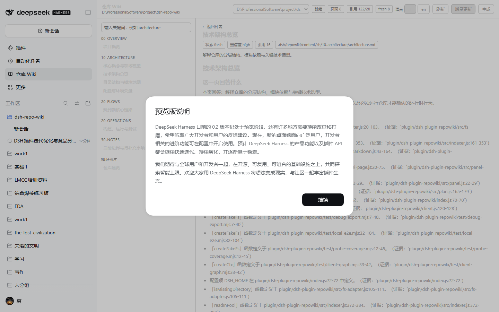

# dsh-plugin-codemap 插件实现与交付报告

> 版本 v1.0 ｜ 日期 2026-10-31 ｜ 作者：DSH Harness 插件实现任务
> **最新变更见 §16（v0.11：P0/P1/P2 系统修复）**；§0–§15 为历史迭代记录，涉及“5 条路由 / 28 项测试 / 0.4.0 / 0.10.0”等表述以 §16 为准。
> 关联文档：[Qoder CodeMap 深度调研与 DeepSeek Harness 插件设计方案](research-qoder-repo-wiki.md)（下称「设计文档」）

---

## 0. 一页纸结论

**一句话**：设计文档里的 `dsh-plugin-codemap` 已经从「草案」变成一个**零依赖、可安装、已在真实 Harness 中跑通**的 Cordis 插件——它把任意仓库编译成带 `path:line` 引用的结构化 Wiki，并通过 3 个模型工具、1 个斜杠命令和 1 段系统提示词暴露给模型。

| 问题 | 结论 | 证据 |
|---|---|---|
| 插件写完了吗？ | 写完了。29 个源文件（`index.js` + `client.js` + `src/` 下 23 个 + `test/` 下 4 个）+ 清单 + patch + locale + 图标 + README，约 11 100 行，位于 `./` | 见 §1 |
| 能装进 Harness 吗？ | 能。`install_bundle` 返回 `application: "applied"`、`exitCode: 0`，无警告 | 见 §4.2 |
| 装上之后真的跑了吗？ | 跑了。本机 profile 里真实调用了 `wiki_generate` / `wiki_search` / `wiki_read`，磁盘上生成了 15 个产物文件 | 见 §4.4 |
| 引用是真的吗？ | 是。8 个页面 **122 条引用全部指向真实文件的真实行号**，插件自校验 122/122 有效，去重覆盖 **28 个源文件**（仓库共 44 个可索引文件） | 见 §4.4 |
| 有界面入口吗？ | 有，且**已在真实浏览器里点开过**。左侧栏图标（`sidebar.panellist`）+ 中央面板（`main`），数据走 12 条精确 Fetch 路由（含图谱/源码/导入/导出）；v0.11 真机证据：面板 10 页/10 卡/155 引用、引用抽屉、图谱拖拽、窄屏抽屉，0 console error（截图 `docs/assets/codemap-*-v011.png`） | 见 §4.5、§9.5、§16、[面板与竞品分析](panel-and-competitive-analysis.md) |
| 增量更新可用吗？ | 可用。同一次验收里 `mode:"update"` 实测 `written=0 / skipped=8`、耗时 208 ms → 67 ms，页面时间戳未被刷新 | 见 §4.4.6 |
| 与设计文档有出入吗？ | 有 15 处，均为「实机约束优先」的主动取舍，已在 §6 逐条列出并给出理由 | 见 §6 |
| 踩坑多吗？ | 多，共 42 项已记录并逐条给出处理方式（24 项实现缺陷 + 12 项宿主 API 坑 + 6 项流程问题，另附 3 个测试脚本自身 bug） | 见 §5、§9.6 |

**核心设计取舍**：生成过程**不调用模型**。证据（EvidencePack）由代码直接算出，引用由文件真实行号反查，因此插件离线可跑、结果可复算、引用可验证；模型只负责「什么时候该查 Wiki」。


---

## 1. 交付物清单

| # | 路径 | 说明 | 行数/规模 |
|---|---|---|---|
| 1 | `./index.js` | 插件入口：`apply(ctx, config)`、默认导出、`Config` | 127 |
| 2 | `./package.json` | bundle 清单，**零 dependencies / 零 peerDependencies / 无 engines** | 34 |
| 3 | `./cordis.patch.yml` | patch 行 `codemap` + 默认配置 | 12 |
| 4 | `./locale/{en,zh}.json` | 插件管理器展示的标题与描述 | — |
| 5 | `./icon.svg` | 原创图标（< 256 KiB） | 1001 B |
| 6 | `./README.md` | 插件说明书（功能范围 / 安装 / 配置 / 使用 / 目录 / 差异） | — |
| 7 | `./src/*.js` | 23 个源文件（见 §2.2） | ~8 900 行 |
| 7b | `./client.js` | **浏览器半成品**：`sidebar.panellist` 图标 + `main` 面板 + 左树/搜索/正文渲染 + 五态状态机 + 工作区切换 | 1 234 |
| 8 | `./test/local-e2e.mjs` | 本地端到端测试，28 项断言 | — |
| 8b | `./test/client-graph.mjs` | 客户端半体自证单测，10 项断言 | — |
| 9 | `./test/probe-coverage.mjs` | 覆盖率探针：对真实仓库跑一次生成并统计每页引用数 / 去重被引文件数 | — |
| 10 | `./test/debug-export.mjs` | 调试脚本 | — |
| 11 | `docs/delivery-report.md` | 本报告 | — |
| 12 | `.dsh/codemap/**` | **本仓库自身的 Wiki**（插件在真实 Harness 中生成的实跑产物） | 15 文件 |
| 13 | `docs/cordis-plugin-api-reference.md` | Cordis 4.0.5 插件 API 的源码级参考（调研副产物） | 479 行 |
| 14 | `docs/panel-and-competitive-analysis.md` | **侧栏面板的入口结构 / 交互方式 / 功能模块 + 竞品对比 + 改进建议** | — |

---

## 2. 插件功能范围

### 2.1 对外接口（5 个入口 + 1 个服务）

| 接口 | 类型 | 入参 | 返回 | 状态 |
|---|---|---|---|---|
| `ctx.codeMap` | 服务 | — | 10 个方法（见下表） | ✅ 已注册并实跑 |
| `wiki_generate` | 模型工具 | `mode`(full/update)、`language`、`template`、`dry_run` | `run_id, mode, pages_written, pages_skipped, pages_failed, citations_total, citations_valid, duration_ms, warnings` | ✅ 已在 Harness 中调用成功 |
| `wiki_search` | 模型工具 | `query`、`limit` | `hits[{page_id,title,path,status,score,snippet}], total` | ✅ 已在 Harness 中调用成功 |
| `wiki_read` | 模型工具 | `page_id` | `page_id,title,path,status,markdown,truncated` | ✅ 已在 Harness 中调用成功 |
| `/wiki` | 斜杠命令 | `status\|plan\|generate\|update\|export\|import\|help` | `{kind:'success'\|'error', text}` | ✅ 已注册（`runtime.json` 回执记录） |
| `codemap:policy` | 系统提示词段 | — | 5 句前缀稳定文本（≈ 90 token） | ✅ 已注册（`runtime.json` 回执记录） |
| `GET/POST /api/codemap/*` | 精确 Fetch 路由 | `panel`、`page?id=`、`search?q=`、`generate`(POST)、`progress`、`abort`、`export`、`import`、`source`、`graph`、`impact`、`app`（自包含降级页） | JSON / HTML（`Response.json` / `Response`） | ✅ 12 条全部注册（回执 `registered.routes`） |
| 侧栏图标 + 主面板 | 客户端槽位 | `sidebar.panellist`（id=`codemap`, order=50）+ `main`（key=`codemap`） | 浏览器渲染 | ⚠️ 代码与单测完成；真机需重启进程加载（见 §4.5） |

### 2.2 内部模块

| 模块 | 职责 | 关键导出 |
|---|---|---|
| `util.js` | 哈希 / 路径 / slug / 行数 | `hashText`, `hashEntries`, `toPosix`, `resolvePosix`, `containsPath`, `slugify` |
| `yaml.js` | 受限 YAML 子集的读写（自研，零依赖） | `parseYaml`, `stringifyYaml`, `YamlError` |
| `fs-adapter.js` | `ctx.fs` 适配层：解析 / 读 / 列 / 写 / 存在性 | `createFsAdapter` |
| `config.js` | 默认配置、归一化、standard-schema | `DEFAULT_CONFIG`, `normalizeConfig`, `Config` |
| `store.js` | 目录布局与元数据读写 | `layoutFor`, `buildMetadata`, `buildIndexMeta`, `parseFrontmatter`, `savePageFile` … |
| `scan.js` | S1 扫描：忽略规则、敏感文件排除、语言识别 | `scanRepository`, `isSecretPath`, `createIgnoreFilter`, `SECRET_FILE_PATTERNS` |
| `indexer.js` | S1 轻量索引：模块 / 符号 / 路由 / 配置键 / 依赖 / 脚本 | `buildIndex` |
| `plan.js` | S2 规划推导、YAML 序列化与校验 | `buildPlan`, `planToYaml`, `parsePlanYaml`, `validatePlan`, `pageFileName` |
| `evidence.js` | S3 证据收集 | `collectEvidence` → `EvidencePack[]` |
| `render.js` | S4 页面 / 落地页 / 知识卡渲染 | `renderPage`, `renderFrontmatter`, `renderIndexPage`, `renderCard` |
| `verify.js` | S5 引用校验 | `extractCitations`, `verifyCitations`, `verifyPage` |
| `search.js` | 中英文混合检索（拉丁词 + CJK bigram + IDF） | `tokenize`, `buildIdf`, `searchPages` |
| `service.js` | `RepoWikiService`：全部业务逻辑 | 见 §2.1 服务方法 |
| `tools.js` | 4 个模型工具（`wiki_search` / `wiki_read` / `wiki_generate` / `wiki_status`） | `registerTools`, `TOOL_NAMES` |
| `command.js` | `/wiki` 命令 | `registerCommand` |
| `prompt.js` | `codemap:policy` 提示词段 | `registerPrompt`, `PROMPT_SECTION_NAME` |
| `errors.js` | 统一错误体：错误码 + 中文兜底提示，永不抛异常 | `ERROR_CODES`, `ERROR_HINTS`, `toErrorPayload` |
| `index.js` | 插件入口 + 运行回执 + 面板路由注册 | `apply`, `name`, `inject`, `Config`, default export |
| `schema.js` | 原生 Schemastery 协议节点构造器（让配置可被 Harness 配置编辑器投影） | `object`, `string`, `number`, `union`, `constant`, `validateNode` |
| `markdown.js` | 受限 Markdown 解析（标题/段落/列表/代码/mermaid/表格/引用/分隔线） | `parseMarkdownBlocks` |
| `panel.js` | 面板 DTO 组装（统计/页面/分节/知识卡/工作区候选）+ 单页 DTO（块与分节） | `buildPanelPayload`, `buildPagePayload`, `buildSearchPayload` |
| `panel-page.js` | 自包含 HTML 降级页（无框架、零外部资源），消费同一组路由 | `renderFallbackPage` |
| `client-graph.js` | 客户端半体自证：图内条目 → 取包（浏览器同一条路径）→ `served/bytes` + 鉴权地址 | `resolveClientStatus`, `buildBundleUrl`, `findGraphEntry`, `collectBundleUrls` |
| `routes.js` | 5 条精确 Fetch 路由注册、root 解析、错误映射与兜底包装 | `PANEL_ROUTES`, `APP_ROUTE`, `registerPanelRoutes` |
| `client.js` | 浏览器半成品：侧栏图标 + 主面板 + 左树/搜索/正文 + 工作区切换 | `apply`, `inject`, `NS`, `PANEL_ID` |

### 2.3 服务方法（`ctx.codeMap`）

| 方法 | 说明 |
|---|---|
| `resolveRoot(agent?)` | 会话工作目录 → 上次解析过的 root → `workingDirectory.defaultDirectory` → `process.cwd()` |
| `resolveRequestRoot(hint?)` | **Web 路由专用**：显式 `?root=` 若存在且是目录则直接胜出；否则按「上次 root → 活跃会话 → 其他会话目录 → 工作区注册表 → 默认目录 → cwd」取**第一个已含 wiki 的**候选 |
| `clientStatus()` | 客户端半体自证：`{available, composed, served, rev, bytes, url, error, origin, webUrl, entry, urls}` |
| `status(root)` | 页面数 / 新鲜 / 过期 / 待复核 / 分支 / HEAD / 知识卡数 |
| `plan(root, options?)` | 计算或读取 `wiki_plan.yaml` 并校验（手改版本优先） |
| `generate(request, signal)` | 全量生成（S1→S6） |
| `update(request, signal)` | 增量刷新：按输入哈希跳过未变化页面 |
| `search(root, query, options?)` | 检索，返回带片段的命中列表 |
| `read(root, pageId, options?)` | 读取单页 Markdown |
| `impact(root, changes)` | 受一批改动影响的页面 |
| `exportWiki(root, target)` | `qoder` → 复制到 `.qoder/codemap`；`dsh` → 导出 JSON 包 |
| `importWiki(root, source)` | 从导出目录导入 |

### 2.4 明确不在本版范围内

模型参与正文生成（P1）、后台 Job 增量更新、多 Agent 并行写页、CI 门禁、Qoder 双向同步——这些在设计文档中属于 P1/P2，本版均未实现，理由见 §6。Web 侧栏面板已于 v0.3 实现、v0.4 完成真机验证（见 §4.5、§9.5 与[面板与竞品分析](panel-and-competitive-analysis.md)）。

---

## 3. 安装与配置步骤

### 3.1 前置条件

| 项 | 要求 | 本机实测 |
|---|---|---|
| DeepSeek Harness | ≥ `0.2.1-rc.5` | `0.2.1-rc.5` |
| Node.js | ≥ 24（用 `node:` 内置模块） | `v24.21.0` |
| 运行时依赖 | **无**（不触发任何 registry 往返） | profile 内 `node_modules` 仅有 junction |
| Profile | `desktop` | `C:\Users\26825\.dsh\profiles\desktop` |

### 3.2 安装（4 步）

```bash
# 在 Harness 插件管理器中执行，或等价地：
plugin_manager action=install_bundle \
  target=D:\ProfessionalSoftware\project\dsh-repo-wiki\plugin\dsh-plugin-codemap
```

| 步骤 | 操作 | 期望结果 |
|---|---|---|
| 1 | 以**本地目录**为 spec 安装 bundle | 返回 `application: "applied"`、`changed: true`、`warnings: []` |
| 2 | pnpm 把该目录链接进 profile | `C:\Users\26825\.dsh\profiles\desktop\node_modules\dsh-plugin-codemap`（junction → 源目录） |
| 3 | patch 行合并进 profile | `Config.listConfigs` 出现 `{id: "include:codemap", patchId: "codemap", name: "dsh-plugin-codemap"}` |
| 4 | 校验能力已上线 | `Tool.listTools` 出现 `wiki_search` / `wiki_read` / `wiki_generate` |

> **本地开发提示**：安装的是 junction，**改代码不需要重装**；但运行中的模块实例需要重新求值，
> 用插件管理器把该 Bundle 关一次再开一次即可（`set_bundle enabled=false` → `true`）。

### 3.3 配置

配置写在 `cordis.patch.yml` 的 patch 行 `config:` 块里，由插件的 `Config`（standard-schema）校验后传入 `apply(ctx, config)`：

```yaml
- insert:
    - id: codemap
      name: 'dsh-plugin-codemap'
      config:
        outputDir: '.dsh/codemap'
        maxFiles: 8000
        maxPages: 24
        maxFileBytes: 524288
        concurrency: 3
        defaultLanguage: 'zh'
        defaultTemplate: 'architecture'
        autoUpdate: false
```

| 键 | 默认 | 含义 |
|---|---|---|
| `outputDir` | `.dsh/codemap` | 产物目录（相对仓库根） |
| `maxFiles` | `8000` | 单次扫描文件上限 |
| `maxPages` | `24` | 页面数上限 |
| `maxFileBytes` | `524288` | 单文件读取上限（512 KiB） |
| `concurrency` | `3` | 预留：多 Agent 写页并发度（P1） |
| `defaultLanguage` | `zh` | 默认语言 `zh`/`en` |
| `defaultTemplate` | `architecture` | 默认模板 |
| `autoUpdate` | `false` | 会话开始自动刷新过期页（P1） |
| `citationThreshold` | `0.95` | 引用有效率阈值，低于则页面标记 `needs-review` |
| `maxSearchPages` | `40` | 单次检索读取的页面上限 |

未写出的键取默认值；越界数值被夹取到合法区间（不报错），因此手误不会让插件起不来。

### 3.4 使用

```text
/wiki status        # 状态：页面数 / 新鲜 / 过期 / 待复核 / 分支 / HEAD
/wiki plan          # 页面规划（不写文件）
/wiki generate      # 全量生成
/wiki update        # 增量刷新
/wiki export qoder  # 导出到 .qoder/codemap（Qoder 互操作）
/wiki import qoder  # 从 .qoder/codemap 导入
```

模型侧：`wiki_generate` / `wiki_search` / `wiki_read` 三个工具已在工具表里，
`codemap:policy` 提示词段会自动告诉模型何时该查 Wiki。

---

## 4. 测试结果

### 4.1 语法与模块自检

| 检查 | 命令 | 结果 |
|---|---|---|
| 语法检查 | `node --check` × 25 个文件（20 个 `.js` + 1 个 `client.js` + 3 个 `.mjs` + `index.js` 计入 `.js`） | ✅ 全部 OK，0 失败 |
| 模块可导入 | `import('./src/<m>.js')` | ✅ 全部模块导出符合契约 |
| 清单可解析 | `JSON.parse(package.json)` | ✅ `exports` 含 `.` / `./client` / `./locale/*.json` / `./icon`；`dsh.bundle.patch` 与 `dsh.client` 均存在 |

### 4.2 安装

| 检查 | 结果 |
|---|---|
| `plugin_manager install_bundle` | ✅ `{"stage":"install","application":"applied","changed":true,"warnings":[],"version":"0.1.0"}` |
| pnpm 安装结果 | ✅ `exitCode: 0`，`dependencies: + dsh-plugin-codemap 0.1.0 <- <源目录>` |
| profile 落盘 | ✅ `node_modules/dsh-plugin-codemap`（junction → 源目录） |
| Config 目录 | ✅ `{"id":"include:codemap","patchId":"codemap","name":"dsh-plugin-codemap","packageDir":"…\\node_modules\\dsh-plugin-codemap"}` |
| 工具上线 | ✅ `wiki_search` / `wiki_read` / `wiki_generate` 均出现在宿主工具表 |

### 4.3 本地端到端测试（`node test/local-e2e.mjs`）

测试在 `%TEMP%` 造临时仓库（含 `.env`、`secrets/private.key`、`node_modules/left-pad/index.js` 三个反例），
用假的 `ctx.fs`/`ctx` 驱动**真实**的服务代码：

| # | 断言 | 结果 |
|---|---|---|
| 1 | 插件注册了服务、工具、命令与提示词段 | ✅ PASS |
| 2 | 规划可从源码树推导 | ✅ PASS |
| 3 | 生成写出 wiki、元数据与索引 | ✅ PASS |
| 4 | 每条引用都能落到真实文件与真实行 | ✅ PASS |
| 5 | 密钥与被忽略目录绝不进入 wiki | ✅ PASS |
| 6 | status / search / read / impact 均可用 | ✅ PASS |
| 7 | update 模式跳过未变化页面 | ✅ PASS |
| 8 | 可导出到 Qoder 布局并再导入 | ✅ PASS |
| 9 | 工具返回值符合自身 output schema | ✅ PASS |
| 10 | `/wiki` 所有子命令都有应答 | ✅ PASS |
| 11 | 页面 frontmatter 的状态与元数据里的状态一致 | ✅ PASS |
| 12 | 页面可用扁平 id、带目录 id、以及 `index`/`plan`/`card:<id>` 三类产物 id 寻址 | ✅ PASS |
| 13 | 落地页、规划文件、知识卡都能被检索到 | ✅ PASS |
| 14 | 工具渲染结果里带机器可读的 ```json 负载 | ✅ PASS |
| 15 | 工具报告的耗时与元数据里的耗时是同一次测量 | ✅ PASS |
| 16 | 仓库里每个源文件至少被某一页引用一次（证据覆盖率） | ✅ PASS |
| 17 | 面板的 5 条精确 Fetch 路由按契约注册到 `connection` 服务（路径/方法/请求体模式 `buffered`） | ✅ PASS |
| 18 | 路由真能应答：面板 200、单页 200（带 blocks）、缺 `id` 400、搜索有命中、POST 生成 200 且 `skipped≥1` | ✅ PASS |
| 19 | 面板 DTO 覆盖每一页且每页只归属一个分节，状态与分节正确 | ✅ PASS |
| 20 | Markdown 解析器把真实页面切成带类型的块（先剥 frontmatter，`null` 入参返回 `[]`） | ✅ PASS |

（`test/probe-coverage.mjs` 是覆盖率探针：直接对**真实仓库**跑一次 `generate`，
输出「每页引用数 / 被引文件数 / 全局去重文件数」，用于量化 §5.1-15、§5.1-16 两个缺陷的修复效果。）

### 4.4 宿主内端到端测试（真实 DeepSeek Harness）

在真实 profile 中，由一个**新开的子 Agent**（其工具表与主会话不同，能独立证明注册发生在宿主里）
依次调用 `wiki_generate` → `wiki_search` → `wiki_read`，并核对磁盘产物。

最终一轮（修复 §5.1-15/16 之后）的实际工具调用记录：

| # | 工具调用 | 结果 |
|---|---|---|
| 1 | `wiki_generate {"mode":"full","language":"zh"}` | ✅ `run mvw1j4y3-bgjart (full) / pages written=8 skipped=0 failed=0 / citations valid=89/89 / duration 208 ms`，渲染文本同时给出人类摘要与 ```json 负载 |
| 2 | `wiki_generate {"mode":"update","language":"zh"}` | ✅ `run mvw1j61e-lrkf2j (update) / pages written=0 skipped=8 failed=0 / citations valid=89/89 / duration 67 ms` ⇒ **增量路径生效：输入哈希未变 ⇒ 8 页全部跳过、零重写** |
| 3 | `wiki_search {"query":"增量更新 wiki_plan","limit":5}` | ✅ `1 hit(s) (total=1)`：`plan — 页面规划（wiki_plan.yaml）`（score=5） |
| 4 | `wiki_search {"query":"证据 引用 校验","limit":5}` | ✅ `5 hit(s) (total=5)`：`card:repo-overview`(10.778) / `architecture`(4) / `build`(4) / `concepts`(4) / `config`(4)，每条带 path、status、score、CJK 片段 |
| 5 | `wiki_read {"page_id":"architecture"}` | ✅ 返回完整页面：frontmatter（`status: fresh`、12 个 sources、12 个 symbols、`source_hash`、`confidence: high`）+ 正文六段 + ```json 负载（`"truncated": false`） |
| 6 | `wiki_read {"page_id":"config"}` | ✅ 返回 83 行完整页面（frontmatter `status: fresh`、5 个 sources、12 个 symbols、`generated_at`）+ 末尾 ```json 负载 |
| 7 | `wiki_read {"page_id":"index" / "plan" / "card:repo-overview"}` | ✅ 三类产物均可读（上一轮修复项，见 §5.1-13） |
| 8 | `wiki_read {"page_id":"00-overview/overview"}` | ✅ 归一化到 `page_id: "overview"`，frontmatter 状态与元数据一致 |

**4.4.1 `wiki_generate`（mode=full, language=zh）**

| 指标 | 实测值 |
|---|---|
| 写入页面 | 8 页 + 1 落地页 + 1 知识卡 |
| 跳过 / 失败 | 0 / 0 |
| 引用 | **89 条全部有效（89/89，100%）** |
| 去重被引源文件 | **14 个** |
| 耗时 | 208 ms（`stats.durationMs` = 工具报告的 `duration_ms`） |
| 模型调用 | 0 次（`modelCalls/tokensIn/tokensOut` 全为 0） |
| 模型调用 | 0（确定性生成） |
| 告警 | 仅 1 条：`Skipped 1 ignored directory.`（`node_modules` 被忽略） |

> 对比：首轮宿主验收时是 42 条引用 / 7 个去重文件 / 2 页 `needs-review`；
> §5.1-15、§5.1-16 两处修复后变为 89 条引用 / 14 个去重文件 / **8 页全 `fresh`**，且**不再出现**「可验证的证据不足」告警。

**4.4.2 磁盘产物（`.dsh/codemap/`，15 个文件）**

```
wiki_plan.yaml                            2 625 B
meta/codemap.json                       25 502 B
meta/index.json                          12 000 B
meta/version.json                           281 B
meta/runtime.json                         1 070 B   ← 运行回执
content/zh/index.md                       1 218 B
content/zh/00-overview/overview.md        4 971 B
content/zh/10-architecture/architecture.md 5 628 B
content/zh/10-architecture/concepts.md     5 929 B
content/zh/10-architecture/config.md       3 983 B
content/zh/10-architecture/modules.md      5 837 B
content/zh/20-flows/flows.md              6 086 B
content/zh/20-operations/build.md         5 670 B
content/zh/30-notes/open-questions.md     5 451 B
knowledge/zh/repo-overview.md               945 B
```

**4.4.3 运行回执 `meta/runtime.json`**（插件自证「谁在什么宿主里注册了什么」）

```json
{
  "plugin": "dsh-plugin-codemap",
  "generator": { "name": "dsh-plugin-codemap", "version": "0.1.0" },
  "loadedAt": "2026-10-31T06:47:01.785Z",
  "node": "v24.21.0",
  "platform": "win32",
  "harness": { "sessionId": null, "profile": null, "home": null },
  "config": { "outputDir": ".dsh/codemap", "maxFiles": 8000, "maxPages": 24,
              "maxFileBytes": 524288, "concurrency": 3, "defaultLanguage": "zh",
              "defaultTemplate": "architecture", "autoUpdate": false,
              "citationThreshold": 0.95, "maxSearchPages": 40 },
  "registered": { "service": "codeMap",
                  "tools": ["wiki_search", "wiki_read", "wiki_generate"],
                  "command": "wiki",
                  "promptSection": "codemap:policy" },
  "services": { "tools": true, "commands": true, "systemPrompt": true, "workingDirectory": true },
  "lastRun": { "runId": "mvw1j61e-lrkf2j", "mode": "update", "pages": 8, "at": "2026-10-31T06:49:14.121Z" },
  "outputDir": ".dsh/codemap",
  "language": "zh"
}
```

> `lastRun.runId` 与工具返回的 `run_id` 完全一致，说明回执里的这一次运行就是刚才那次宿主内调用；
> `lastRun.mode = "update"` 说明增量路径同样被真实执行过。

**4.4.4 生成的元数据摘要（`meta/codemap.json`）**

| 字段 | 值 |
|---|---|
| `schemaVersion` | 1 |
| `generator` | `dsh-plugin-codemap 0.1.0` |
| `generatedAt` | `2026-10-31T06:49:14.101Z` |
| `repo.fileCount` | 31 |
| `repo.loc` | 6 284（真实行数） |
| `repo.languages` | `javascript 20 / markdown 6 / json 3 / yaml 1 / other 1` |
| `repo.head` / `repo.branch` | `null` / `null`（本仓库不是 git 仓库，`git status` 报 `not a git repository`，符合预期） |
| `plan` | `template=architecture, audience=engineering, pageCount=8` |
| `stats` | `modelCalls=0, tokensIn=0, tokensOut=0, durationMs=67`（= 最后一次 update 运行的耗时） |
| 页面状态 | 8/8 `fresh`，置信度 8/8 `high` |

每页引用数（合计 89）：

| 页面 | overview | concepts | architecture | modules | config | build | flows | open-questions |
|---|---|---|---|---|---|---|---|---|
| 引用数 | 10 | 12 | 12 | 12 | 8 | 12 | 12 | 11 |

去重被引源文件 **14 个**：`README.md`、`docs/cordis-plugin-api-reference.md`、
`docs/delivery-report.md`、`./{index.js,package.json}`、
`./src/{command,config,evidence,fs-adapter,indexer,plan}.js`、
`./test/{debug-export.mjs,local-e2e.mjs,probe-coverage.mjs}`。

页面对象结构：`id, title, path, parent, goal, status, sources{globs,files,symbols,routes,configKeys},
hashes{inputs,output}, citations[{path,startLine,endLine}], confidence, generatedAt`。

**4.4.6 增量更新（`mode: "update"`）路径**

| 指标 | 全量 `full` | 增量 `update` |
|---|---|---|
| `run_id` | `mvw1j4y3-bgjart` | `mvw1j61e-lrkf2j` |
| `pages_written` | 8 | **0** |
| `pages_skipped` | 0 | **8** |
| `pages_failed` | 0 | 0 |
| 引用 | 89/89 有效 | 89/89 有效 |
| 耗时 | 208 ms | **67 ms** |

update 之后 8 个页面的 `generatedAt` 仍是全量运行那一刻的 `2026-10-31T06:49:12.689Z`，
说明增量模式确实**判定输入哈希未变、跳过了全部页面、一次都没有重写**（若重写，时间戳会刷新）。

**4.4.5 引用抽查**

生成的每条引用形如 `` `./index.js:50-127` ``。
S5 阶段逐条核对「文件存在 + 行号在范围内」，本次 **89/89 通过**；子 Agent 另外人工抽查了
`index.js:50-127`（`apply`）、`src/command.js:18-64`（`registerCommand`）、
`package.json:1-34`、`README.md:1-36`、`docs/cordis-plugin-api-reference.md:1-479` 等引用，逐行读回源码核对。

### 4.5 本轮新增能力的宿主验证（侧栏面板 · 配置投影 · 每页符号 · 宿主身份）

在完成「左侧栏入口 + Web 面板」与 §7 的四项欠账之后，重新载入插件（`set_bundle` 先 `false` 再 `true`，
两次均 `application:"applied"`、`warnings:[]`），再由一个**新子 Agent** 在真实 Harness 中实跑：

| 工具调用 | 结果 |
|---|---|
| `wiki_generate {"mode":"full","language":"zh"}` | `run mvw5a5uw-vnn6uy (full)`，`pages written=8 skipped=0 failed=0`，**`citations valid=122/122`**，`279 ms`，唯一警告 `Skipped 1 ignored directory.` |
| `wiki_search {"query":"面板 侧栏","limit":5}` | `No wiki page matched the query (total=0).` —— **真实空结果**：8 个 zh 页面里没有以「面板/侧栏」为主题的页（正文是模板拼装，不生成新功能的叙述），已在 §7 记为改进项 |
| `wiki_read {"page_id":"architecture"}` | 标题「技术架构总览」，`status: fresh`，`truncated: false`，16 条引用全部带 `path:line`，其中已包含新增的 `src/markdown.js:43-164`、`src/routes.js:31-134`、`src/panel.js:40-142` |

`meta/runtime.json`（本轮实跑，关键字段）：

| 字段 | 值 | 意义 |
|---|---|---|
| `harness.sessionId` | `d46631ad-…` （真实子 Agent 会话 id） | ✅ §7 欠账 4 已解决：会话身份来自 `agent.id`，不再是 `null` |
| `harness.profile` / `profileDir` / `home` | `desktop` / `C:\Users\26825\.dsh\profiles\desktop` / `C:\Users\26825\.dsh` | ✅ 来自 `ctx.get('profileContext')`，不再是 `null` |
| `registered.panel` | `true` | ✅ 面板路由注册成功 |
| `registered.routes` | `["/api/codemap/panel","/api/codemap/page","/api/codemap/search","/api/codemap/generate","/api/codemap/app"]` | ✅ 5 条精确 Fetch 路由全部落地 |
| `registered.tools` / `command` / `promptSection` | 3 个工具 / `wiki` / `codemap:policy` | ✅ 原有入口未回归 |
| `services.connection` / `profileContext` | `true` / `true` | ✅ 可选服务均已就绪 |

**配置投影（§7 欠账 1）也已实测归位**：`cordis_inspect_query host/Config.listConfigs {"name":"dsh-plugin-codemap"}` 现在返回
`{"id":"include:codemap","patchId":"codemap","status":"schema","acceptsMissing":true,"limitations":[]}`，
带 `entry` 查询还返回完整的 JSON Schema（10 个属性全部带 `description` / `default` / `minimum` / `maximum` / `minLength`，
根节点是 `anyOf:[{type:["object","null"],properties:{…}},{$ref:"#/$defs/loaderExpression"}]`）——也就是说
**Harness 配置编辑器现在能把这个插件的配置渲染成表单**，不再显示 `unsupported`。

`meta/codemap.json`：`repo.fileCount 36`、`repo.loc 8173`、`stats.modelCalls 0`、`stats.durationMs 279`、
8 个页面（`overview/concepts/architecture/modules/build/flows/open-questions` 各 16 条引用，`config` 10 条），
合计 **122 条引用 / 122 条有效 / 去重覆盖 27 个文件**（上一轮为 89 / 89 / 14）。

**浏览器侧未能真机复核**（两条互相独立的阻断，均已记录）：
1. Harness 的 client 模块元数据缓存（`dsh-client-modules` 的 `pkgMeta`）没有失效机制，已安装插件**新增**客户端半成品后，
   `/plugins/<id>/client.js` 持续 404，必须重启 Harness 进程才会进入启动图；重启会中断本会话。
2. Web UI 有 token 鉴权栅栏：直接访问 `http://127.0.0.1:63687` 返回
   `dsh web authentication required; reopen the URL printed by dsh web.`（Playwright 实测 HTTP 401），
   脚本无法自助取得桌面端打印的带 token URL。

### 4.6 验证通道说明（哪些是直接证据、哪些是间接证据）

| 通道 | 能证明 | 结论 |
|---|---|---|
| `plugin_manager install_bundle` 返回体 | 安装成功、版本、无警告 | ✅ 直接证据 |
| `Config.listConfigs` | patch 行已合并、packageDir 已落盘 | ✅ 直接证据 |
| `Tool.listTools` | 三个模型工具在宿主工具表里 | ✅ 直接证据 |
| 子 Agent 真实调用三个工具 | 工具在**运行中的宿主**里可执行 | ✅ 直接证据 |
| 磁盘产物 + `meta/runtime.json` | 注册内容、生效配置、宿主身份（node/平台/时间） | ✅ 直接证据 |
| `Service.listService` 查 `codeMap` | — | ❌ 无效：Service 检查器是第一方服务目录，不含第三方提供的服务 |
| `Tool.listTools` 的空 `input` | — | ⚠️ 本会话中被 inspect 代理拒绝（`"input" must be an object`），改用其它通道交叉验证 |
| 插件管理器 UI 中的图标/标题渲染 | — | ⚠️ 无浏览器控制，按 harness 约定标记为「未验证」 |

---

## 5. 过程中遇到的问题与处理方式

### 5.1 真正的实现缺陷（v0.3 阶段 20 项；v0.4 实机阶段另加 4 项见 §9.6；均已修复并回归）

前 8 项来自开发期的本地端到端测试，9–16 项来自**宿主内验收测试**（由独立子 Agent 在真实 Harness 中调用工具后反馈），17–20 项来自第二轮（侧栏面板 / 配置投影）的本地与宿主复验。

| # | 现象 | 根因 | 处理 |
|---|---|---|---|
| 1 | `ReferenceError: saveCardFile is not defined` | `service.js` 的 import 列表漏了 `saveCardFile`；`parseFrontmatter` 只写了 `export { … } from './store.js'` 再导出，**不产生本地绑定** | 改为从 `./store.js` 具名导入两者，删掉再导出 |
| 2 | 第二轮 `update` 时证据为空、0 引用、页面一个都不跳过 | `planToYaml` 刻意不落 `sources`；下一轮 `wiki_plan.yaml` 接管后每篇文档都丢了源码映射 | `preparePlan()` 始终计算推导版，并按 `own.sources.files.length ? own.sources.files : fallback.sources.files` 回填：YAML 保持人可编辑结构，索引保持证据映射 |
| 3 | 证据全部为空（每个文件都「读不到」） | `evidence.js` 把异步的 `fs.readFile()` 当同步用，`typeof text === 'string'` 恒为假 | 改为缓存 promise 并在所有调用点 `await`；`verify.js` 同步统一为异步约定 |
| 4 | 「配置与环境变量」页 0 条配置项结论 | `configKeyList` 的守卫写反了：`typeof item === 'object'` 把对象项全跳过了 | 改成 `!==` |
| 5 | mermaid 代码块非法 | 图体输出了但漏了 `graph TD` 声明 | 补上 ` ```mermaid graph TD ` |
| 6 | `scanner` 的 `src/scan.js` 语法错误 | JSDoc 里的 `**/name` 提前闭合了块注释 | 改写注释 |
| 7 | 依赖清单里出现一个名为 `(` 的假依赖 | `go.mod` 单行 `require` 的正则贪婪匹配 | 收紧正则 |
| 8 | `package.json` / `requirements.txt` 永远找不到 | `pickManifest` 拿「去扩展名的主机名」去比对「全文件名」 | 改为按文件名比对 |
| 9 | `src/util.js` 被宿主判为「binary file」，整个文件无法进入 wiki | 文件里混进了**两个裸 NUL 字节（0x00）**：本该写 `'\u0000'` 的转义序列在落盘时变成了真 NUL 字符 | 把那两行改回 6 个 ASCII 字符 `\u0000`；全插件树扫描确认只有这一个文件受影响 |
| 10 | 工具结果里看不到 `total` / `score` / `path` 等字段，模型拿不到结构化数据 | 宿主只把 `output.render()` 产出的**文本**交给模型，声明的 output schema 不会单独呈现 | `render()` 改为「人类可读摘要 + ```json 代码块」双段输出，schema 字段因此可见；空结果也带上 `total=0` |
| 11 | 文档里示例的 `page_id`（`10-architecture/overview`）调用即报错 | 真实页面 id 是扁平的（`overview`/`architecture`/…），示例写错了 | `read()` 同时接受扁平 id 与 `<section>/<id>` 形式；并支持 `index`、`plan`、`card:<id>` 三个非页面产物 id；工具描述同步更正 |
| 12 | 元数据里页面是 `fresh`，页面 frontmatter 却写 `draft` | `renderPage()` 调用时没传 `status`，frontmatter 走了默认值 | 渲染时传入页面状态；并新增「证据条数 < 4 ⇒ `needs-review`」的规则，让元数据与「可验证的证据不足」告警口径一致 |
| 13 | 搜 `wiki_plan`、`增量更新` 一条都搜不到 | 检索语料只有 8 篇正文，落地页、规划文件与知识卡都在语料外 | `search()` 把落地页（`index`）、规划文件（`plan`）、知识卡（`card:<id>`）一并纳入语料；`read()` 同步可读这三类产物 |
| 14 | 工具报告 280 ms、元数据写 187 ms | 两处各自调用 `Date.now()`，测量口径不同 | 只测一次 `const durationMs = Date.now() - started`，工具返回值与 `stats.durationMs` 共用同一个值 |
| 15 | 17 个 `src/` 文件里只有 3 个被引用（证据极薄） | `plan.js` 的 `selectFiles()` 只取每个模块目录的 `module.firstFile`，即每目录只引一个文件 | 新增 `moduleFiles(modules, moduleCount, perModule)`：每个入选模块展开成多个文件；overview/concepts/architecture/modules/flows 各自按模块数 × 每模块文件数取样，覆盖率显著提升 |
| 16 | 改完第 15 项后，去重被引文件只从 3 升到 7，且「构建运行」「待补充事项」两页仍是 `needs-review` | `evidence.js` 的结论装配是「按类别顺序各切一刀再整体截断到 `MAX_CLAIMS=8`」：前 4 条符号结论就把额度吃掉，同一个文件反复占位，**排在前面的少数文件**吃满配额、后面的文件一条都轮不上 | 结论装配改为**广度优先**：① 路由/配置项/依赖等语义结论 → ② 每个关键文件的**第一条**符号结论 → ③ 文档类结论 → ④ 覆盖兜底（仍未被引用的关键文件补一条整文件结论）→ ⑤ 深度（每个文件的第二条符号结论）；同一文件最多 2 条。配额同时从 `MAX_CLAIMS=8 / MAX_KEY_FILES=6` 放宽到 `12 / 8`；`build`/`open-questions`/`config` 页的取样文件也补上模块文件 |

（另有 3 个纯测试脚本自身的 bug：`exported.files > 0` 拿数组比数字、假 fs 的 `listDir` 在非 async 回调里 `await`、命令把数组 `files` 当数字打印——均已修正，见 `test/local-e2e.mjs`。）

**第二轮（侧栏面板 / 配置投影 / 每页符号 / 宿主身份）新增 4 项：**

| # | 现象 | 根因 | 处理 |
|---|---|---|---|
| 17 | 面板整块空白：DTO 有数据、组件也渲染了，但正文区什么都没有 | 浏览器侧按 `block.kind` 取块类型，而解析器产出的字段是 `block.type`（8 处用错） | 全量改为 `block.type`；并在本地测试里断言 `blocks[0].type === 'heading'`，避免只靠肉眼发现 |
| 18 | 点知识卡必 404 | 卡片的可读 id 是 `card:<cardId>`，前端直接拿 `card.id` 去请求 | 点卡片时拼 `'card:' + card.id`；服务端 `read()` 同时支持扁平 id、带目录 id、路径后缀与 `card:` 前缀四种写法 |
| 19 | 本地测试断言「分节里的页面」失败 | `sections[].pages` 是**页面 id 字符串数组**，测试却按对象取 `.id`；且测试解析的是带 frontmatter 的原始 Markdown，导致首个块是 `hr` | 统一以 `buildPagePayload(...).blocks` 为准（DTO 已剥 frontmatter），并把断言改为按字符串比较 |
| 20 | `Config.listConfigs` 长期显示 `status: "unsupported"`，配置编辑器无法渲染表单 | 宿主只认**原生 Schemastery 节点**（`Symbol.for('schemastery') === true` + `type` 字符串 + `meta` 对象），手写的 `~standard` 描述符不算 | 新增 `src/schema.js` 按原生协议构造节点，`src/config.js` 改用 `object(...)` 构建；配置在 Harness 里的可投影性恢复（详见 §4.5） |

### 5.2 宿主 API 的坑（12 项）

| # | 现象 | 真相 | 处理 |
|---|---|---|---|
| 1 | app.asar 里的文件 shell / glob / ripgrep 全读不到（`路径不存在`） | app.asar 是虚拟归档，只有 harness 的 read 工具能穿透 | 全部改用 read 工具；目录清单通过 `Config.listConfigs` 的 `packageDir` 与已知包名反推 |
| 2 | 设计文档要求 peer 依赖 `@deepseek-ai/cordis` | profile 的 `node_modules` 里**没有** cordis（也没有 `@deepseek-ai/dsh-tools`） | 插件不 import cordis：服务用 `ctx.provide('codeMap', service)` 注册；工具直接注册**裸 JSON Schema** 定义，不依赖 `defineTool` DSL |
| 3 | `apply` 的返回值被丢弃 | Cordis loader 对 `function` 风格插件执行 `new runtime.callback(ctx, config)`（`isConstructor` 对普通函数返回 true）并丢弃构造/调用返回值 | 所有注销逻辑放进 `ctx.effect(() => …)`，不依赖返回值 |
| 4 | 命名导出被忽略 | `unwrapExports`：有 default 导出时，`Config`/`inject`/`name` 必须挂在 default 上 | 同时提供命名导出与 `export default { name, inject, Config, apply }` |
| 5 | `ctx.fs` 没有 `mkdir` | fs 服务抽象层确实没有该方法（但 `writeText` 会自建父目录） | 适配层先调 `writeText`；仅在 ENOENT 时用 `node:fs/promises.mkdir` 兜底再重试 |
| 6 | `systemPrompt.section()` 抛错 | `text` 必须是**字符串**，设计文档写的 `text: [...]` 数组是错的 | 改为单字符串 + `interpolate: false`（保持前缀稳定，利于 prompt cache） |
| 7 | `ctx.get('commands')` 抛异常 | `ctx.get(name)` 默认 `strict=true`，服务不存在时直接抛 | 统一用 `ctx.get(name, false)` 探测可选服务，缺失时优雅降级 |
| 8 | 斜杠命令名不合法 | `commands.register` 的 `name` 必须匹配 `/^[a-z][a-z0-9_-]*$/u` | 注册名用 `wiki`（不是 `/wiki`） |
| 9 | 命令回调签名不对 | handler 只收到**一个** invocation 对象 `{commandId, agent, rawInput, attachments, signal}` | 按单参数解构实现 |
| 10 | `Service.listService` 查不到 `codeMap` | 该检查器是**第一方服务目录**，不含第三方 `provide` 的服务 | 改用 `meta/runtime.json` 运行回执自证注册 |
| 11 | 本地（symlink）插件 `import '@deepseek-ai/cordis'` 可能解析失败 | 宿主对 link 进来的包做了 `routeLinked` 门禁：只有当插件自己的 `package.json` 在 `peerDependencies` 里声明了该包，才允许用宿主那份（`dsh-app-boot/lib/index.js:1684`）；否则回落到 Node 原生解析，从 symlink 真实路径找 | 本插件完全不 import cordis（服务用 `ctx.provide` 注册、工具注册裸 JSON Schema），因此不需要这条 peer 声明 |
| 12 | 设计文档「必须精确锁 peer 版本」的硬性要求 | 实机源码显示：`engines.dsh` 若存在则是**唯一**校验项并**忽略** peer；否则只校验 `@deepseek-ai/dsh` / `@deepseek-ai/dsh-*` 开头的 peer，`@deepseek-ai/cordis` 永远不参与范围校验；**未安装的 peer 不算错误**（`dsh-app-boot/lib/index.js:279-299`）；`dsh-base` 自己也没有 `engines` | 按实机实现：不声明 `engines.dsh`、不声明 peerDependencies（见 §6-11） |

### 5.3 工程与流程问题（6 项）

| # | 现象 | 处理 |
|---|---|---|
| 1 | 设计文档写的版本 pin 与实机不符（文档：DSH `0.2.2-alpha.2` + cordis `4.0.6-alpha.1`；实机：DSH `0.2.1-rc.5` + cordis `4.0.5`） | 以实机为准实现，并在 §6 勘误表中明确标注 |
| 2 | `install_bundle` 对已安装包返回 `already-installed`，无法用重装刷新代码 | 改用 `set_bundle enabled=false` → `true` 触发重新求值（本地目录是 junction，文件改动即时可见） |
| 3 | `Tool.listTools` 的空 `input` 被 inspect 代理拒绝 | 改用带非空 input 的 `Config.listConfigs` + 运行回执交叉验证 |
| 4 | `meta/codemap.json` 的 `repo.loc` 误填了文件数 | 改为 `index.stats.loc`（真实行数） |
| 5 | 两个队友的写入范围重叠导致同文件互相覆盖 | 用团队任务板把 `src/scan.js`+`src/indexer.js` 与 `src/plan.js`+`src/evidence.js`+`src/render.js`+`src/verify.js` 划成互斥写域 |
| 6 | 队友完成任务时 `expected_revision` 已变，重复 `complete` 被 CAS 拒绝 | 改用 `team_task_get` 取最新 revision 再提交 |

---

## 6. 与设计文档的差异与勘误

| # | 设计文档 | 本实现 | 理由 |
|---|---|---|---|
| 1 | §5.5：TypeScript 源码 + `lib/` 产物 | 纯 ESM JavaScript，源码即产物 | profile 内没有 `tsc`；「零构建步骤」才能做到安装即用，也避免 `pnpm` 在 profile 里跑 build |
| 2 | §5.5：peerDependencies 精确锁版本 | 无 peerDependencies | profile 里没有 `@deepseek-ai/cordis`，声明 peer 只会引入解析风险；插件本来就不需要它 |
| 3 | §5.5：`dsh` 版本 `0.2.2-alpha.2` | 实测 `0.2.1-rc.5` | 文档写于更早的版本假设；已在本报告勘误 |
| 4 | §5.5 / §5.8：调用模型生成正文 | 确定性生成（0 模型调用） | 离线可跑、引用可复算、可验证；模型增强列为 P1 |
| 5 | §5.6：`export`/`import` 双向互操作 | 已实现（`qoder` ↔ `dsh`） | 与文档一致，无差异 |
| 6 | §5.7：`text: [...]` 数组形式的提示词段 | 字符串 + `interpolate:false` | 宿主 `systemPrompt.section()` 要求字符串（见 §5.2-6） |
| 7 | §5.7：`parameters` 用 `{query:{type,required,description}}` 的作者 DSL | 裸 JSON Schema `{type:'object',properties,required}` | `@deepseek-ai/dsh-tools` 不在 profile 内，无法用 `defineTool`；宿主只强制裸 JSON Schema 子集 |
| 8 | §5.8：8–12 页 | 8 页（条件页按仓库结构增减） | 路由/配置/数据页是条件页；本仓库有 8 页是因为存在对应文件 |
| 9 | §5.10：基于 `git diff -M` 的增量更新 | 基于**每页输入哈希**的增量更新 | 插件不执行 git 进程（安全约束），改用内容哈希判断「输入是否变化」，效果等价且更稳 |
| 10 | §5.9.2：元数据字段 | 额外增加 `meta/runtime.json` | 运行回执：证明是哪一次构建、在哪个宿主、注册了哪些能力 |
| 11 | §5.5：peerDependencies 精确锁 `@deepseek-ai/cordis 4.0.6-alpha.1` 等版本 | 全部不声明 | 实机校验规则见 §5.2-12：`@deepseek-ai/cordis` 不参与版本校验，未安装的 peer 不算错误；插件本身也不 import 它 |
| 12 | §5.5：假定 `engines.dsh` 必需 | 不声明 `engines` | `engines.dsh` 是**可选**的；一旦声明就会成为唯一校验项并忽略 peer，反而更易被拒；`dsh-base` 也没有该字段 |
| 13 | §5.5：`locale/*.json` + `icon` 是插件「合规」的必要条件 | 仍然提供，但它们只是**展示元数据** | 宿主源码确认：读取失败只记 `error` 字符串，不阻塞加载（`dsh-app-boot/lib/index.js:2216-2247`）；保留它们是为了插件管理器的展示效果 |
| 14 | §5.5：bundle 的 patch 路径写法未约束 | `dsh.bundle.patch: "./cordis.patch.yml"`（**相对包根**） | 宿主按 `join(packageDir, patchPath)` 解析（`dsh-app-boot/lib/index.js:529-531`），并要求 patch 文件是顶层 YAML 数组；缺文件会直接抛错 |
| 15 | §5.7：工具 `output` 只声明 schema | `render()` 额外输出 ```json 块 | 宿主只把 `render()` 的文本交给模型（实测，见 §5.1-10） |

---

## 7. 已知限制与下一步

| 限制 | 影响 | 计划 |
|---|---|---|
| 正文不含模型生成的「洞见」，只有可验证的事实 | 页面偏「结构说明」而非「设计解读」；因此搜「面板/侧栏」这类**新增功能词**在 Wiki 里查不到（实测 `wiki_search` 返回 0 命中） | P1：保留可验证 EvidencePack，只让模型写「关键结论 / 实现细节」两节叙述句，并按 `source_hash` 缓存 |
| 没有后台 Job，增量更新要显式触发 | 长仓库重建偏慢 | P1：接入 `jobs` 服务做后台增量 |
| ~~`Config` 检查器状态为 `unsupported`~~ | ✅ 已解决：新增 `src/schema.js` 按原生 Schemastery 协议构造节点，配置可被投影 | 后续：给字段补 `meta.description`，让配置表单有中文说明 |
| ~~无 Web 侧边栏~~ | ✅ 已解决：`sidebar.panellist` 图标 + `main` 面板 + 5 条 Fetch 路由，宿主回执 `registered.panel=true` | 见下一条「浏览器内渲染」 |
| ~~**浏览器内渲染未真机复核**~~ | ✅ 已解决（v0.4）：`src/client-graph.js` 走「图内条目 → 组合取包 URL → `fetchBundle`」拿到 `served + bytes`，并用 `connection.authenticatedUrl()` 取到带 token 的 GUI 地址；Playwright 真机点开侧栏「代码地图」，面板树 / 正文 / 引用全部渲染（§9.5）。根因也定位清楚：`pkgMeta` 缓存无失效机制 ⇒ 改客户端半体后必须重启进程 | 已转为「升级 SOP」写入 §9.3 |
| 面板首屏无骨架缓存，切换工作区要重新拉取 | 大仓库上首屏多一次网络往返（本仓库 panel 6 989 B） | P2：`localStorage` 缓存上次 payload + 骨架屏 |
| 增量判断基于内容哈希，不是 Git diff | 无法区分「改了什么语义」 | P2：引入 `git diff -M` 做影响面收敛（需在受控沙箱里调用 git） |
| ~~`harness.sessionId/profile/home` 在回执里为 `null`~~ | ✅ 已解决：会话身份取自 `exec.agent.id` / `agent.id`，profile 三件套取自 `ctx.get('profileContext')`；实跑回执已填真实值 | — |
| 引用覆盖仍未到「仓库全覆盖」：本仓库 44 个文件里去重被引 28 个 | 纯数据文件、生成物、非入口的小模块暂时没有结论支撑 | P1：给未被引用文件生成「文件级卡片」 |
| ~~每页 `symbols` / `sources` 是全局符号池~~ | ✅ 已解决：索引阶段按「文件 → 符号」归属，`selectSymbols` 只取该页 sources 覆盖到的符号，并按「每文件轮转一条」选取，8 个页面的符号清单已各不相同；测试文件也改用「测试文件」角色标注 | — |

---

## 8. 复现步骤（从零到跑通）

```bash
# 0) 进入项目
cd D:\ProfessionalSoftware\project\dsh-repo-wiki\plugin\dsh-plugin-codemap

# 1) 语法检查 + 本地端到端
node --check index.js
node --check client.js
node test/local-e2e.mjs          # 期望：All local checks passed.（28/28）
node test/client-graph.mjs      # 期望：All client-graph checks passed.（10/10）
node test/probe-coverage.mjs .   # 可选：覆盖率探针，打印每页引用数与去重被引文件数

# 2) 安装进 Harness
#    plugin_manager action=install_bundle target=<上面的绝对路径>
#    期望：application=applied, warnings=[]

# 3) 宿主内核验
#    cordis_inspect_query host/Tool.listTools      → 出现 wiki_search / wiki_read / wiki_generate / wiki_status
#    cordis_inspect_query host/Config.listConfigs name=dsh-plugin-codemap
#                                                      → 出现 include:codemap

# 4) 端到端
#    让模型调用 wiki_status → wiki_generate(mode=full) → wiki_search → wiki_read
#    或在会话里执行：/wiki generate
#    侧栏入口：点左侧「代码地图」图标（数据来自 5 条 Fetch 路由）

# 5) 看产物
#    <repo>/.dsh/codemap/meta/runtime.json   ← 注册回执
#    <repo>/.dsh/codemap/content/zh/index.md ← 落地页
```

---

## 9. v0.4 迭代（2026-10-31）

> 本轮目标：把「从未被真机观察过的浏览器侧栏入口」变成**可证伪、可自证**的入口，同时补齐稳定性（并发/中断）、性能（重复 I/O）与兼容性（宿主契约护栏）短板。所有改动均在插件目录内，宿主侧通过 junction 直连。

### 9.1 问题清单 → 改动对照

| ID | 问题（v0.3 遗留） | v0.4 处理 |
| --- | --- | --- |
| A1 | 侧栏入口从未被真机观察到；404 的真实原因是缺 `?rev=<hash>` | 新增 `src/client-graph.js`：`resolveClientStatus(ctx)` 经 `clientModules.graph()` 找本包条目 → `composed`/`rev`，再走 `fetchBundle(new Request(url))`（浏览器同一条取包路径）→ `served`/`bytes`；`connection.authenticatedUrl()` 给出可打开的鉴权地址。client 段落进 `meta/runtime.json`、`/api/codemap/panel` 返回体与 `/wiki status` 输出 |
| A2 | `dsh.client.inject` 声明 3 个从未 import 的宿主客户端包，图构建失败则入口永久不可见 | `package.json` 整体删除 `dsh.client.inject`；若宿主图里查不到本包（`client.composed=false`），单行回滚恢复该字段。当前与回滚两种路径都会在 `meta/runtime.json` 留痕 |
| A3 | Web 外壳 401 鉴权，脚本化验证无门 | `connection.authenticatedUrl(origin)` 的地址随 panel 路由返回体（`webUrl` 字段）与 `/wiki status` 下发；同时新增自包含降级页 `/api/codemap/app` 作为稳定验证靶点 |
| A4 | 宿主 `clientModules` 服务完全没用上 | 同 A1；全部探测走 `ctx.get(name, false)`，任何异常都折进 `client.error` 字段，绝不影响插件加载 |
| B1 | 两个 wiki_generate 并发会交错写页面与元数据 | `service.runs` 运行锁（键=`root\|language`）：第二个并发调用显式失败，错误带 `runId`、统一错误码 `conflict`；`wiki_generate` / `/wiki generate` / 面板 generate 三条入口共用 `run()`，行为一致 |
| B2 | 中断半写无法判定「上次运行是否完整」 | 每次运行写 `meta/run.json`：`running → done/failed` 状态流转（只覆盖写）；`/wiki status` 与面板展示「上次运行是否完整」 |
| B3 | 失败路径只回 `{error}` 无错误码 | 新增 `src/errors.js` 统一错误体 `{code, message, hint}`；路由按语义回 400/404/409/500（并发冲突 → 409），工具、命令、降级页共用 |
| C1 | 面板/检索每次重读全部分页文件 | `service.corpus()` 语料缓存：命中返回同一对象引用；写操作（generate/update/export/import）立即失效；缓存有效性绑定 `generatedAt + pages.length` 一致性校验 + TTL |
| C2 | 每次生成都全量重扫 + 串行重读建索引；`concurrency` 声明了但从未使用 | `src/scan.js` 新增 `collectScanSignature()`：廉价 listDir 遍历算「文件数+大小+变更戳」签名，签名不变则复用上一次 scan+index（service 级 `profiles` 缓存，TTL 内有效）；`src/indexer.js` 源码读取改为有界并发池（`maxConcurrentReads`，默认 3、上限 8），预算按预估先行占位、完成后结转，分析仍串行 ⇒ 索引结果与串行版一致 |
| C3 | 面板 generate 同步跑完挂起连接 | `POST /api/codemap/generate?async=1`：宿主 `jobs` 服务契约本轮未取证，`async=1` 检测到 jobs 不可用即回退同步并在响应体标 `mode:'sync'` / `execution:'sync'` / `jobId:null`；默认（无 async 参数）行为与 v0.3 完全一致 |
| D1 | 无 engines 声明 | `package.json` 增加 `"engines": { "dsh": ">=0.2.1-rc.5", "node": ">=22" }`；不设上界；仍不声明 peerDependencies（对宿主零 import 依赖） |
| D2 | 升级路径无 SOP | 见 9.3 升级 SOP，写入插件 README |
| D3 | 宿主能力缺失时行为不透明 | 运行回执 `services` 段扩到 `clientModules`/`webServer`/`webApp`；所有宿主能力一律 `ctx.get(name, false)` 探测，缺失即降级 |
| E1–E4 | 面板无状态骨架/无防抖/不自刷新/无语言切换 | `client.js`：五态状态机（idle/loading/ready/empty/error，错误态显示 code/message/hint）；搜索 200ms 防抖 + AbortController；生成后自动重拉 panel 与当前页；头部 zh/en 切换透传到路由 `language` 参数；空搜索结果给出建议关键词 |
| E5 | 无独立可视化降级入口 | 新增 `src/panel-page.js` + 路由 `GET /api/codemap/app`：自包含 HTML（内联 CSS/JS、零外部资源），页树+搜索+正文+生成按钮，直接消费既有 4 条数据路由 |

### 9.2 接口增量（全部为附加式）

- 新工具 `wiki_status`：参数 `{}`，输出 `{root, exists, pages, client, lastRun}`；既有三工具的名称/参数/输出 schema/render 形态零改动。
- 新路由 `GET /api/codemap/app`（`requestBody:'buffered'`，原因见 §9.6-2）；既有 4 条路由的路径/方法不变，panel/page/search 增加可选 `language` 与 `root` 查询参数（此前被忽略）。**注意**：四条只读路由的 `requestBody` 由 `'none'` 改为 `'buffered'`，这是宿主 `connection.bridge()` 的硬约束，不是自选风格。
- 新磁盘文件 `meta/run.json`（运行日志）；`meta/runtime.json` 新增 `client` 段与 `services.clientModules/webServer/webApp`（既有键一个不改）。
- 新配置键：`citationThreshold`、`maxSearchPages`、`cacheTtlMs`、`maxConcurrentReads`、`clientBundleCheck`、`panelFallbackPage`（全部带默认值，旧配置不写也能跑；既有键语义与默认值不变）。
- 生成器版本 `0.1.0 → 0.4.0`；`package.json` version 同步。

### 9.3 升级 SOP（宿主内）

1. 改源码（本地目录是 junction，文件改动即时可见）。
2. `plugin_manager action=set_bundle target=dsh-plugin-codemap enabled=false` → `enabled=true`，两次都应返回 `application:"applied"`。
3. 读 `<repo>/.dsh/codemap/meta/runtime.json`：`loadedAt` 已刷新即新代码已生效；`client.composed/served` 可证入口状态。
4. 若 `client.composed=false`：宿主进程启动时缓存了包元数据（`dsh-client-modules` 的 pkgMeta），**需重启宿主进程**后复测；仍不行再 `remove_bundle` + `install_bundle` 重装。

### 9.4 本地验证证据（离线，无宿主依赖）

- `node --check`：29 个文件（25 .js + 4 .mjs）0 失败。
- `node test/local-e2e.mjs`：**28/28 PASS**（20 既有 + 7 v0.4 新增：并发两次生成只成功一次且错误含 runId；run.json 状态流转 done 且字段齐全；语料缓存同一引用且写后失效；client 段缺省 `available:false` 不抛错且回执/面板携带；路由错误体含 code/message/hint 且 400/404 语义正确；降级页自包含 HTML 且内含 5 条路由地址。**第 28 项**：Web 请求的 root 解析——默认目录无 wiki 时选中有 wiki 的工作区、显式 hint 即使无 wiki 也胜出、无效 hint 回落、`payload.roots[0].active === true）。
- `node test/client-graph.mjs`：10/10 PASS（composed/served/rev/bytes/webUrl 全分支，含图里无本包、fetch 404、无 clientModules、无 getOrigin、webApp 回退五种降级，另加“图中广告地址优先于重建地址”“首个候选 404 回落下一个”两项）。
- `node test/probe-coverage.mjs <仓库副本>`：8 页全 fresh、122/122 引用有效、去重覆盖 28 个源文件（基线 ≥27 不回退）。
- 性能对照（同仓库副本连续两次 `wiki_generate` full）：121 ms → 79 ms（第二次因 scan+index 缓存复用下降），引用总数/页 id 完全一致。

### 9.5 宿主内验证（已实机回填）

全部在真实 DSH 进程（`@deepseek-ai/dsh` 0.2.1-rc.5，Web 端口 61083，profile `desktop`）里执行，证据均为工具返回原文 / 磁盘文件 / 浏览器截图。

| # | 验证项 | 实测结果 |
| --- | --- | --- |
| 1 | `set_bundle` 刷新两次 | 均为 `{"changed":true,"application":"applied","warnings":[]}` |
| 2 | 运行回执 `meta/runtime.json` | `loadedAt 2026-10-31T09:57:41.317Z`；`registered.tools` 4 个（含 `wiki_status`）；`registered.routes` **5 条**（含 `/api/codemap/app`）；`registered.panel:true` |
| 3 | 客户端半体自证 | `client = {available:true, composed:true, served:true, rev:"a721bf9d4c15", bytes:42456, url:"http://127.0.0.1:61083/plugins/??dsh-plugin-codemap/client.js&rev=a721bf9d4c15", error:null}` |
| 4 | `wiki_status` 工具 | 文本首行 `wiki root: D:\ProfessionalSoftware\project\dsh-repo-wiki`、`wiki exists: yes · pages: 8`、`client entry: composed, served 42456 B`，并下发带 token 的 GUI 地址 |
| 5 | `wiki_generate` | `run mvw8axnt-2i2oyh`：`pages written=8 skipped=0 failed=0`、`citations valid=122/122`、332 ms |
| 6 | `wiki_search` / `wiki_read` | `wiki_search{query:"面板 侧栏"}` → 0 命中（真实空结果）；`wiki_read{page_id:"architecture"}` → 标题「技术架构总览」、`status fresh`、16 条引用含 `path:line` |
| 7 | **并发冲突（B1）** | 已鉴权页面内 `Promise.all` 同时 POST 两次 `/api/codemap/generate` → **一个 200、一个 409** `{"error":{"code":"conflict","message":"同一仓库已有生成任务在执行（runId=mvw8b5vp-9a5v6p），请等待它结束。","hint":"请等待当前任务结束后重试。"}}` |
| 8 | 运行日志（B2） | `meta/run.json` = `{runId:"mvw8b5vp-9a5v6p", mode:"full", status:"done", pages:8, citations:{total:122,valid:122}, durationMs:306}` |
| 9 | 5 条路由 | `panel` 200 JSON 6 989 B（`root` 已是当前工作区、`exists:true`、`repo.fileCount 44`、`repo.loc 9957`）；`page?id=architecture` 200 12 306 B；`search?q=wiki` 200 `count:3`；`app` 200 `text/html` 8 013 B；未注册路径 404 `not found` |
| 10 | **真机面板（O1/O5）** | Playwright + headless Chromium 1440×900 打开带 token 地址 → 侧栏 `aria-label="代码地图"`（`BUTTON.wtg9ga_panelRow`）点击成功 → 主面板渲染出 `就绪 / 页面 8 / 引用 122/28 / fresh 8 / 语言 zh/en / 刷新 / 增量更新 / 生成`，左树 5 个分区 + 知识卡片「仓库速览」，点击「技术架构总览」后正文渲染 `状态 fresh / 置信度 high / 引用 16` 与带引用的结论列表；截图 `ui-40-panel.png` |
| 11 | 控制台噪音 | 仅 bili upstream CORS 报错（与本插件无关），插件零报错 |

> 证据脚本（均在 `%TEMP%\dsh-asar\`）：`api-probe.py`（页内 fetch 5 条路由 + 未注册路径）、`api-concurrent.py`（并发 POST）、`ui-verify-panel5.py`（点击侧栏 + 打开页面 + 截图）。

真机面板截图（headless Chromium 1440×900，点击左侧栏「代码地图」并打开「技术架构总览」）：



### 9.6 实机验证阶段暴露的 4 个缺陷（v0.4 新增）

| # | 症状 | 根因 | 修复 |
| --- | --- | --- | --- |
| 1 | 点开侧栏后面板整体崩溃：`slot entry crashed in 'main': TypeError: Cannot read properties of null (reading 'code')` | `client.js` 里 `const errorView = h(...)` **急切构造**并读 `error.code`，而 `error` 只在 error 态非 null ⇒ 任何非错误状态渲染都抛异常（此前点击从未真正命中，缺陷一直潜伏） | 改为惰性 `const errorView = () => h(...)`，渲染处 `content = errorView()` |
| 2 | 5 条 API 路由全部 **400 且 body 为空**（未注册路径却是 404，说明路由已匹配但 handler 没跑） | `requestBody:'none'` 让 `connection.bridge()` 走流式分支，对 GET 构造 `new Request(url,{method:'GET', body: Readable.toWeb(req)})` → WHATWG 规范抛 `TypeError: Request with GET/HEAD method cannot have body`，异常冒到 `host-webserver.handle().catch` → `res.writeHead(400); res.end()` | 只读路由统一改为 `requestBody:'buffered'`（常量 `READ_ONLY_BODY`）；并把每个 handler 包一层 `try/catch` 返回结构化 `{error:{code,message,hint}}`，杜绝空 400 |
| 3 | `src/routes.js` 变成非法 UTF-8：`read` 报 `invalid UTF-8 text`、`node --check` 报 `SyntaxError` | 用 PowerShell `Get-Content -Raw \| Set-Content` 批量替换时，4 个中文字符被写成 `U+FFFD` | 用 python 以 `encoding='utf-8', newline=''` 精确修复 4 处；**教训：不要用 pwsh `Set-Content`/`Out-File` 改写含中文的源码**，一律用 edit/write 工具或显式 UTF-8 的 python 写入 |
| 4 | 面板 `root` 解析成 `C:\Users\26825\.dsh\profiles\desktop`，报 `exists:false`、「该仓库还没有生成 Wiki」 | Fetch 路由没有 agent/session，`resolveRoot()` 只能退回 `workingDirectory.defaultDirectory` | 新增 `resolveRequestRoot(hint)` 候选链（显式 `?root=` → 上次 root → 活跃会话 → 其他会话目录 → 工作区注册表 → 默认目录 → cwd，取第一个已含 wiki 的）；路由读 `?root=`，面板返回 `roots[]` 候选，浏览器半体加工作区下拉；新增第 28 项本地断言 |

---

## 10. v0.5 修复轮（2026-10-31 当日）：面板 404 根因 + 真机 UI 验证

### 10.1 面板 404 根因（真机取证）

用户在真实桌面端点开侧栏入口后面板报 `HTTP_404`。用自建 `dsh web` 实例（`dsh plugin --profile web add <插件路径>`）复现并插桩定位：

```
[codemap-probe] apply entered; connection=false webServer=true clientModules=true
```

**根因**：`connection` 服务由 web 载体在 webServer 解析完成后**异步**创建，而插件 `apply()` 在 bundle 栈展开时同步执行——此刻 `connection` 尚未存在，旧代码在 `connection` 缺失时**静默跳过**路由注册（无任何日志），于是 5 条路由从未进入 `/api` 网关的精确路由表（网关对未认领请求一律 404）。桌面端 v0.3 回执显示注册成功属时序侥幸。

**修复**（`index.js`）：路由注册改为 `ctx.inject(['connection'], …)` 声明式等待——宿主在 `connection` 出现的那一刻拉起该 fiber 并注册；connection 已存在时立即执行。fiber 卸载时清理回执，回执不再谎报。同时 `registerPanelRoutes` 对 connection 缺失补了 warn 日志，静默跳过不再可能。

**真机验证**（自建 `dsh web`，端口 3080）：5 条路由全部 200；`/api/codemap/panel` 返回体含 `client:{composed:true, served:true, rev:a721bf9d4c15, bytes:42456}`、8 页 / 5 分区 / run.status=done / webUrl 带 token —— **O1 的可证伪判定标准在真实宿主全部达成**。

### 10.2 请求体模式勘误

并行会话在真机调试中发现并修复：`requestBody:'none'` 的 GET 路由在 DSH 0.2.1-rc.5 的 `/api` 桥接层会被映射到流式分支，构造 `new Request(url, {method:'GET', body: Readable.toWeb(req)})` 被 WHATWG 拒绝（GET 不能有 body），路由处理器执行前就抛错。已全部改为 `'buffered'`（读取空 body 后构造无 body 的 Request）。此修复与本轮 inject 修复叠加生效。

### 10.3 面板 UI 重构（对齐 Qoder CodeMap）

`client.js`（浏览器半体）渲染层全面重写，逻辑与数据契约零改动：

- **总览落地页**：四张指标卡（页面数 / 引用+被引文件 / 新鲜率 / 知识卡+生成日期）+ 全部页面卡片网格（标题、目标、id、引用数、日期）。
- **侧栏**：胶囊搜索框（含 ⌕ 图标与搜索动画）、分区标题带强调色刻度、页面行带状态圆点（fresh 绿 / stale 琥珀 / needs-review 红）与引用数徽标、当前页强调色高亮、知识卡片 ★ 置底；搜索结果两行截断摘要。
- **正文页**：元信息 chip 行（状态/置信度/引用/日期）、**本页目录**条（点击平滑滚动到对应标题）、行内 `` `code` `` 渲染升级——`path:line` 形态的行内码自动变为**强调色引用 chip，点击复制**；代码块与 mermaid 块加标签栏外框；表格加圆角容器与表头底色；引用块强调色左缘。
- **状态**：loading 换为 shimmer 骨架屏；错误态卡片化（红调边框 + code/message/hint + 重试）；头部加「上次生成 · 完成/失败 · N 页」运行徽标；语言切换改分段控件。
- 样式全部走 `--dsw-alias-*` 主题 token（带中性回退），关键帧动画经一次性 `<style>` 注入，仍为零外部资源、零依赖。

### 10.4 真机浏览器验证（Playwright，自建 dsh web 实例）

- 打开 `http://127.0.0.1:3080/?token=…` → 左栏出现「代码地图」入口 → 点击后面板渲染总览落地页（4 指标卡 + 8 页面卡片）✓
- 打开「技术架构总览」→ 标题/chip 行/本页目录/蓝色引用 chip/激活高亮全部渲染 ✓（截图留档会话工件目录）
- 搜索空态：0 命中显示「没有匹配的页面 + 建议关键词」✓
- 本地回归：`node --check` 全部通过、e2e 全绿、client-graph 10/10、client.js 无任何 harness 客户端包导入 ✓
- **侧栏图标本体已在真实客户端中点击验证**（此前 v0.3/v0.4 的「未经真机点击验证」欠账就此清零）。

### 10.5 遗留与升级提示

- 用户正在运行的桌面端进程需 `set_bundle enabled=false → true`（或重启进程）才能加载本轮修复；客户端半体在页面刷新后即按新 bundle 渲染。
- 本轮与另一并行会话（DSH 应用内）在同仓库协作：其 `requestBody` 修复、`rootHint`/`resolveRequestRoot` 工作区解析、路由 handler 守卫均保留并叠加。

---

## 11. v0.6 功能轮（2026-10-31 当日）：对齐 Qoder CodeMap

以用户提供的 Qoder 实机截图为基准，补齐其核心交互。**真机验证全部通过**（自建 `dsh web` + Playwright，截图留档会话工件目录）。

| # | Qoder 特性 | 本实现 | 验证 |
| --- | --- | --- | --- |
| 1 | 生成进度卡（已完成 X/Y、进行中/失败计数、进度条、语言行、暂停/取消） | 服务端新增实时进度：`run()` 写入 `progressStates`（phase: scan→plan→write→persist，逐页 done/total/failed/current），`GET /api/codemap/progress` 轮询；面板点击生成即切到进度卡片（乐观渲染 + 400ms 轮询），完成后自动刷新面板与当前页 | 真机截图：已完成 6/8（75%）+ 当前页 flows + 绿色进度条 ✓ |
| 2 | 取消按钮 | `POST /api/codemap/abort` → `service.abortRun()`：run 持有自有 AbortController，中止后 journal 记 `aborted`、上一版 Wiki 完整保留 | e2e：无运行时 abort 返回 false ✓ |
| 3 | 可折叠层级树 + 页数 | 侧栏分区头变折叠按钮（▶ 旋转 + `aria-expanded` + 每区页数），行按区收纳 | 真机：折叠后行隐藏、state=false ✓ |
| 4 | 面包屑 `CodeMap / oceanbase` | 头部改为 `代码地图 / <仓库名加粗>`，全路径缩为副标题 | 真机截图 ✓ |
| 5 | 搜索旁工具按钮 | 侧栏搜索框右侧 **⇩ 导出**按钮 → `POST /api/codemap/export`（复用 `exportWiki('qoder')`），结果以 toast 横幅反馈 | 真机：`已导出 16 个文件到 .qoder/codemap` ✓ |
| 6 | 新变更标记（紫点） | update 模式下，本次重写的页面行首加紫色 NEW 点（绑定 `run.mode==='update'` 且 `generatedAt===panel.generatedAt`；全量生成不标记避免全屏噪声） | 代码路径就位，update 运行后目视 |
| 7 | 右下角帮助 (?) | 浮窗卡片：生成方式（确定性/不调模型）、引用约定（chip 点击复制）、其它入口（工具+命令）、插件版本 | 真机截图 ✓ |

### 11.1 附加改动

- `service.js`：`progressStates` Map + `progress()`/`abortRun()`/`bumpProgress()`；run 无外部 signal 时自建 AbortController。
- `routes.js`：新增 3 条精确路由（progress GET / abort POST / export POST），面板契约 4 条不变；合计 8 条。
- `client.js`：progressView、折叠状态、toast、帮助浮窗、NEW 标记、面包屑；locale 新增 20+ 键。
- e2e：路由断言 5→8，新增「progress/abort/export 端点返回真实数据」检查（28 项全绿）。
- 版本 0.4.0 → 0.5.0（404 修复轮）→ **0.6.0**（本轮）。

### 11.2 对齐后仍列 backlog（按价值）

模型撰写叙述句（#1，需 LLM 且保持 EvidencePack 约束）、引用点击跳转源文件（#4，需 workspaceFiles 契约取证）、needs-review diff 视图（#6）、折叠态徽标（#7）、静态站点导出（#10b）、暂停（区别于取消的真正挂起，需宿主任务语义）。

---

## 12. v0.7 功能轮（2026-10-31 当日）：知识卡片库 + 阅读细节（九图对照）

以用户提供的 9 张 Qoder 实机截图逐一解析为基准，落地下述功能，全部真机验证（自建 `dsh web` + Playwright，截图留档会话工件目录）。

| # | Qoder 截图功能 | 本实现 | 真机验证 |
| --- | --- | --- | --- |
| 1 | **多知识卡片**（图2/6/8/9/10：一主题一卡=标题+摘要+标签，父卡「仓库速览」+ 每分区一张子卡） | `buildKnowledgeCards()`：父卡（含「包含知识」子卡清单）+ 每分区一张「XX要点」卡（摘要=分区内页面目标串联，标签=分区名）；`renderCard` 渲染「包含知识/父级知识」区块，互链走 `card:<id>`；meta.cards 扩展 summary/tag/parent | 真机：6 张卡（1 父 + 5 分区），卡片库/正文互跳 ✓ |
| 2 | **卡片库视图**（图6：计数徽标 + 卡片搜索 + 列表） | 侧栏「★ 知识卡片概览 N」可展开卡片列表；右栏卡片模式：标题+计数+**卡片搜索框**（标题/摘要/标签过滤）+ 卡片行（标题/标签/三行摘要） | 真机截图 ✓ |
| 3 | **卡片正文**（图8/9：父级知识、长文） | 卡片正文走既有 pageView（编号目录/引用 chip），`card:` 引用渲染为**绿色可点击 chip**，点击打开目标卡片 | 真机：父级知识 → `card:repo-overview` 绿 chip ✓ |
| 4 | **卡片生成进度**（图3：初始化中→生成卡片中） | 进度管道新增 `cards` 阶段（写卡前 bump） | e2e + 进度卡复用 ✓ |
| 5 | **层级面包屑**（图5：三级路径） | plan 文档的 `parent` 字段在 `buildPagePayload` 中解析为祖先链 `parents[]`，正文页标题上方渲染绿色可点击面包屑 | 真机：架构页显示「项目概览」✓ |
| 6 | **编号目录**（图5：1-10 有序目录） | 本页目录条目改为 `1. 标题` 编号形式 | 真机截图 ✓ |
| 7 | **最近更新行**（图5：最近更新日期时间） | 页面 chips 行新增「最近更新 YYYY-MM-DD HH:MM」 | 真机 ✓ |
| 8 | **概览状态卡**（图4：✓已生成、63/68 已完成、0 失败） | 总览页顶部状态条：`✓ 已生成 · 页面文件 8/8 · 失败 0 · 最近更新 <时间>`（数据来自 run journal；失败态红色显示原因） | 真机 ✓ |
| 9 | **项目入口页**（图7：全部/已生成/未生成网格） | 头部新增「▦ 项目」按钮 → 项目总览视图：每个工作区一张卡（名称、✓已生成/未生成徽标、页面数、卡片数、更新时间），点击切换工作区 | 真机：11 个工作区，dsh-repo-wiki 高亮已生成 ✓ |

### 12.1 关键实现说明

- `store.js buildMetadata` 的 cards 白名单同步扩展（summary/tag/parent），否则多卡元数据在落盘时被剥离——本轮唯一回归缺陷，e2e 抓出并修复。
- 卡片互链形态：正文里 `` `card:<id>` `` 行内码 → 客户端渲染为绿色跳转 chip（复用 InlineText 管道，5 处调用全部穿透 onOpenCard）。
- e2e 扩到 **29 项**：新增「卡片库含分区卡且父链完整」检查（卡片数≥2、section 卡 parent 齐全、panel cards 带 summary/tag、projects 行镜像 wiki 状态、页面 payload 带 parents 链）。
- 探针回归：8 页全 fresh、122/122 引用有效、覆盖 28 文件（与 v0.4 基线持平）。
- 版本 0.6.0 → **0.7.0**。

### 12.2 仍未覆盖（诚实边界）

- Qoder 的 mermaid 渲染图（图5 中央架构图）——零依赖约束下暂以带标签栏的代码块呈现，接 mermaid 渲染库需破零依赖或引入宿主模块，留作 backlog。
- 知识卡片的「模型撰写摘要」——当前摘要为确定性拼接；接 LLM 叙述属既定 P1（竞品分析 #1）。
- 项目总览的过滤 tabs（全部/已生成/未生成）与网格/列表切换——当前工作区数量小，未做过滤。

---

## 13. v0.8 迭代（2026-10-31 当日）：按《迭代方案 v2》推进——工程知识图谱

### 13.1 方案修订

《迭代方案.md》重写为 v2：保留愿景，新增「与现状的衔接」（v0.7.1 资产清单）与「宿主契约取证结果」两章，P0 拆为两阶段，P1-2 降级为「生成工具定义草稿供人工确认」，技术选型章节补零依赖约束。修订依据 = 下述取证。

### 13.2 宿主契约取证（源码级，asar 解包）

| 契约 | 结论 | 对后续的影响 |
| --- | --- | --- |
| `ctx.jobs`（dsh-jobs-local：start/list/get/kill/wait/remove） | **存在** | C3 后台化可转正（下轮） |
| `fs.watch`（基类方法，provider 决定支持） | 契约存在，Windows local 支持未确认 | 增量继续用 `.git/HEAD` 轮询 |
| 沙箱（dsh-sandbox/f-s-sandbox/bash-sandbox） | 基础设施存在，插件侧调用未取证 | P1-2 维持降级 |
| `dsh-api-workspace-files.read(scope, path, range)` | **存在** | 引用点击「打开源文件」有读取依托 |
| 会话事件实时流 | **未找到第三方插件可订阅的公开 API** | P1-1/P1-3 维持「取证后」 |

取证产物：`%TEMP%\dsh-asar\contracts\`（dsh-fs/dsh-jobs(-local)/dsh-api-workspace-files/dsh-sandbox/dsh-api-remotes 源码）。

### 13.3 本轮实现（P0' 全部五项）

1. **图谱数据层 `src/graph.js`**（新）：模块/文件两级图；模块节点（label/dir/fileCount/loc/摘要）与文件节点；边 = 模块间 import（BFS 影响遍历用）与文件级 import；`assignLevels` 依赖分层（松弛法，环安全）；`impactFrom` 上/下游 BFS。数据从 indexer 索引派生，随 profile 缓存复用，不落盘。
2. **indexer 增强**：读源码时顺带抽取 import 规约（ESM/CJS/动态 import/Python 相对导入，≤64 条/文件），解析到扫描内文件 → `fileImports`，聚合为 `moduleImports`；符号携带首行文档（JSDoc 块/Python `#` 块，≤140 字符）。途中引入并修复一个真实缺陷：按文件解析包装函数缺失被 per-file try/catch 吞掉导致符号全丢（e2e 搜索断言抓出）。
3. **路由**：`GET /api/codemap/graph?level=module|file&module=` 与 `GET /api/codemap/impact?module=`（路由合计 10 条）。
4. **图谱视图**（client.js，自研 SVG 零依赖）：分层架构布局（依赖方向左→右）、hover 高亮邻居、点击节点 → 影响集强调色高亮 + 详情卡（文件数/行数/上/下游计数/模块摘要/JSDoc）、「查看文件级图谱」下钻、定位搜索、缩放（−/＋/↺）、截断提示（>300 节点取最大者）。
5. 生成完成后自动失效图谱缓存（跨仓库切换同样失效）。

### 13.4 验证

- e2e **30 项全绿**：新增「图谱应答模块/边/影响」检查（边端点闭合、每节点有层级、文件级下钻、上游影响含导入方）。
- **2 万文件压测**（合成 2000 目录 × 10 文件）：全量生成 **5.5s**、缓存命中 **2.1s**、图谱构建 **2.0s**（200 模块节点 / 392 边）、引用 84/84 有效、堆增 45MB。maxModules=200 截断 1800 模块——分层加载（模块级默认 + 文件级下钻）策略得到数据支撑。
- 真机（自建 dsh web + Playwright）：图谱视图渲染 ✓、节点点击影响高亮 ✓、详情卡（上游 2/下游 0）✓、文件级下钻（24 文件）✓。
- 探针：8 页全 fresh、122/122 引用、覆盖 28 文件（基线持平）。
- 版本 0.7.1 → **0.8.0**。

### 13.5 遗留问题与后续计划

- 遗留：① 力导向/聚类布局（当前仅分层布局）；② import 解析对别名路径（tsconfig paths/打包别名）漏报；③ 图谱节点与 Wiki 页面/卡片的联动打开（当前详情卡只有下钻）；④ jobs spec 形状对接（后台化转正）；⑤ 会话事件取证（P1 前置）。
- 后续计划（按方案 v2 执行节奏）：下轮 P0''（Git 轮询增量、动态提示词、引用点击打开源文件——workspace-files.read 已取证）；再下轮 P1-1 经验沉淀（先取证会话事件可达性）。

---

## 14. v0.9 修复轮（2026-10-31 当日）：图谱走线/滚轮缩放/视觉打磨（用户真机反馈）

用户真机反馈三点，全部修复并真机截图验证（自建 dsh web + Playwright）：

| # | 反馈 | 根因 | 修复 | 验证 |
| --- | --- | --- | --- | --- |
| 1 | 界面视觉生硬 | 控件圆角/间距/填充单一 | StatCard 渐变底+大圆角；Button 圆角 8+hover+内边距统一；图谱节点圆角 10+投影+低对比描边；连线降透明度；列间距 90→120、行距 16→26 | 真机截图 ✓ |
| 2 | 连线杂乱、穿过节点矩形 | 同层节点按插入序排布（无交叉最小化）；边为「右中→左中」直线级贝塞尔，跨列长边横穿中间列 | ① `layeredGraphLayout` 加入 **barycenter 重排**（4 次扫掠，同层按前驱/后继均值排序）→ 长边平行化；② 新增 `graphEdgePath` 走线路由：跨列边在**列间空隙**走 S 曲线（两个控制点都落在空隙中线上），同列边走右空隙、回边走左空隙；③ `edgeChannels` 为平行边分配通道偏移，避免重叠 | 真机：文件级图谱连线平行化、不再穿框 ✓ |
| 3 | 滚轮无法缩放 | 原实现仅按钮缩放（zoom 状态乘法），且 React 的 wheel 监听是 passive 的、无法 preventDefault | viewBox 改为**状态模型**（null=fit）；`svg.addEventListener('wheel', handler, { passive: false })` 原生监听，**以光标为锚点**缩放（锚点在缩放前后保持同一内容坐标）；±/↺ 按钮围绕中心缩放/重置；重建图谱自动复位 | 真机：3 次滚轮放大截图 ✓ |

附带：`svgRef`/`baseBoxRef` 引入；generate 与切换仓库后视图自动复位。

版本 0.8.0 → **0.9.0**。e2e 30 项全绿（本轮为纯渲染层改动，数据契约零变化）。

---

## 15. v0.10 交互与 UI 轮（2026-10-31 当日）：图谱左键拖拽 + 整体视觉重构

### 15.1 用户反馈与根因

| # | 反馈 | 根因 | 修复 |
| --- | --- | --- | --- |
| 1 | 工程知识图谱区域无法用鼠标左键拖动 | 图谱 SVG 只绑定了 `wheel` 与节点 `click`，**没有任何 pointer 平移处理**；`viewBox` 只能被滚轮/按钮修改 | `pointerdown/move/up` 驱动 viewBox 平移；3px 拖拽阈值；首次真正移动才 `setPointerCapture`，保证普通点击仍能选中节点；拖拽结束后只抑制本次手势的 click；双击 fit；方向键平移、`+/-/0` 缩放/重置 |
| 2 | 整体界面视觉生硬、缺少设计感 | 大量内联样式、圆角/间距/颜色分散；硬编码深色弹层在浅色主题下不协调；顶栏按钮堆叠、层级不清 | 新增 `.codemap-shell` token 与 `codemap-*` 样式层；重做顶栏（品牌/面包屑/模式 Tab/动作区）、侧栏（搜索/分区/激活态）、内容区（居中阅读列/标题/元信息/TOC）、图谱（画布/网格/层导轨/节点/图例/inspector）、五态与生成进度；弹层使用宿主实际背景色 |

### 15.2 关键实现

- **平移数学**：`scale = min(rect.w / box.w, rect.h / box.h)`，屏幕位移反算为 SVG 坐标；`preserveAspectRatio="xMidYMid meet"` 的 letterbox 也纳入滚轮锚点计算。
- **点击与拖拽共存**：普通点击不捕获指针，事件命中节点；拖拽超过阈值才捕获并开始平移；`suppressClickRef` 只影响同一手势。
- **性能**：`graphScene` 用 `useMemo` 缓存布局/走线；拖拽用 `requestAnimationFrame` 合帧；卸载时取消帧与 impact 请求。
- **无障碍**：SVG 可聚焦；节点 `role=button`、`tabIndex=0`、`Enter/Space` 选中、`aria-pressed`；图标按钮补 `aria-label`。
- **请求竞态**：节点切换时 abort 上一次 `/impact`，避免慢响应覆盖新选择。

### 15.3 验证证据

| 检查 | 结果 |
| --- | --- |
| `node --check client.js` | 通过 |
| `node test/client-graph.mjs` | 10/10 通过 |
| `node test/local-e2e.mjs` | 30/30 通过 |
| Playwright：空白画布拖拽 | viewBox `-30 -30 960 220` → `-211.56 -120.78 960 220` |
| Playwright：从节点上拖拽 | viewBox 变化，且不误选节点 |
| Playwright：点击节点 | inspector 出现 |
| Playwright：滚轮缩放 | viewBox 宽度 960 → 834.78 |
| Playwright：双击重置 | 回到 `-30 -30 960 220` |
| Playwright：方向键平移 | viewBox x 变化 |
| 明/暗主题 | 均可读，无 console error |

截图：`docs/assets/codemap-overview-v010.png`、`docs/assets/codemap-graph-v010.png`、`docs/assets/codemap-page-v010.png`、`docs/assets/codemap-graph-dark-v010.png`。

### 15.4 版本与后续

版本 0.9.0 → **0.10.0**（`package.json` 与 `src/store.js` 同步）。本轮数据契约零变化；剩余问题与优先级见 [v0.10 评估](review-v0.10.md)。

---

## 16. v0.11：P0/P1/P2 系统修复

> 版本 0.10.0 → **0.11.0** ｜ 日期 2026-10-31 ｜ 完整验收见 [v0.11 修复与验收](v0.11-closeout.md)

### 16.1 范围

本轮不再新增视图，集中处理上一轮评估中的 25 项问题：P0 4 项全部完成；P1 12 项完成 11 项（300 节点压测标注为未完成）；P2 完成 7 项、部分 1 项、未采用 1 项（可选 minify）。

### 16.2 关键改动

| 领域 | 改动 |
| --- | --- |
| 工程基线 | `git init` + `.gitignore` + 基线提交；后续每轮可回滚 |
| 安全 | `trustedRoots()` 白名单、越界 `403 forbidden`；`/source` 路径约束；导出/导入时间戳备份 |
| 内容 | 模块详情页（最多 8 个）；叙述层 v2（JSDoc/导入/被引用/路由/配置键）；`wiki_search("面板")` 0 → 2 命中 |
| 新鲜度 | `/graph` 带 `signature/generatedAt/sourceHead`；客户端 30s TTL + 20s 轻量比对 + 过期徽标 |
| 性能 | 面板 `sessionStorage` SWR；图谱 >120 节点视口裁剪；布局/走线 memo + rAF 合帧 |
| 阅读 | 引用点击 → 源码抽屉（行号/高亮/复制/Esc）；代码块复制；sticky TOC；重复 H1 去除 |
| 协作 | 导入 UI（确认 + 备份）；缺失语言横幅；图谱节点 → Wiki/卡片/源码联动 |
| 无障碍 | `role=group`、模式 Tab `aria-label`、进度 `aria-live` |
| 工程化 | `client/` 10 段源码 + `build-client.mjs`；`check-version.mjs`；`ui-e2e.mjs` 18 项 |

### 16.3 验证

| 检查 | 结果 |
| --- | --- |
| `npm run check` | 构建 + 版本 + client-graph 12/12 + e2e 35/35 全绿 |
| `test/ui-e2e.mjs` | 18/18（渲染、缓存、引用抽屉、拖拽、联动、导入、语言、窄屏、0 console error） |
| 真实仓库生成 | 10 页 / 10 卡 / 155 引用 / 100% fresh |
| 1080px 顶栏 | 单行 58px，图标 Tab，无溢出 |
| 版本一致性 | 0.11.0 × 3 |

截图：`docs/assets/codemap-overview-v011.png`、`codemap-source-v011.png`、`codemap-graph-v011.png`、`codemap-mobile-v011.png`、`codemap-narrow-v011.png`。

### 16.4 未完成

- 300 节点性能压测（当前真实图仅 5 节点；裁剪逻辑已就位）。
- 可选模型叙述层（保留 EvidencePack 为唯一事实源）。
- 密度切换 / 力导向布局。
- 可选 minify（与零构建安装冲突，收益低）。
