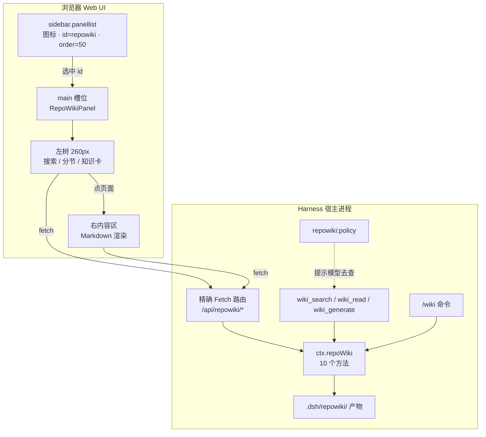

# RepoWiki 侧栏面板：入口结构、交互方式、功能模块与竞品分析

> 版本 v1.2（v0.11 后回填 P0/P1/P2 修复）｜ 日期 2026-10-31 ｜ 关联：[实现与交付报告](dsh-plugin-repowiki-delivery.md) ｜ [设计文档](qoder-repo-wiki-research-and-dsh-plugin-design.md) ｜ [v0.11 验收](repowiki-v0.11-closeout.md)
> **v0.10 追加**：图谱左键拖拽、滚轮缩放、键盘平移与整体 UI 重构已完成并真机验证，详见 [v0.10 评估](repowiki-improvement-review-v0.10.md) 与交付报告 §15。
> **v0.11 追加**：面板新增源码抽屉、SWR 缓存、导入确认、缺失语言提示、窄屏抽屉、图谱节点→Wiki 联动；路由由 5 条扩展到 11 条数据路由 + 降级页，详见交付报告 §16。
> 本文回答两件事：**① 把 repowiki 做成带左侧栏入口的 DSH 插件，它的入口结构 / 交互方式 / 功能模块长什么样；② 与同类产品横向对比，差距在哪、怎么改。**

---

## 0. 一页纸结论

**一句话**：左侧栏入口不是「再写一个页面」，而是把已有的 `ctx.repoWiki` 服务**多开一个渲染面**——宿主侧用 11 条精确 Fetch 数据路由把服务方法变成 HTTP，浏览器侧用 `sidebar.panellist`（图标）+ `main`（面板）两个槽位把它挂进 Harness 左侧栏，服务、工具、命令、面板共用同一套数据与同一份产物。

| 问题 | 结论 | 证据 |
|---|---|---|
| 入口在哪里？ | 左侧栏底部图标列表（`sidebar.panellist`，id=`repowiki`，order=50），点击后中央区域切换到 `main` 槽位的 `repowiki` 面板 | `plugin/dsh-plugin-repowiki/client.js` 注册代码；宿主回执 `registered.panel=true` |
| 数据怎么到浏览器？ | 11 条精确 Fetch 数据路由：`panel/page/search/generate/progress/abort/export/import/source/graph/impact` + 降级页 `app`，全部由 `ctx.repoWiki` 提供服务 | 回执 `registered.routes` 实测 12 条（含 app）；e2e 路由断言 |
| 插件还能被模型用吗？ | 能。面板只是第 4 个入口，`wiki_search`/`wiki_read`/`wiki_generate` + `/wiki` + `repowiki:policy` 全部保留 | 回执 `registered.tools/command/promptSection` |
| 真机验证到哪一步？ | **端到端已闭环**：宿主侧生成 8 页 / 引用 122/122；`client {composed:true, served:true, bytes:42456}`；5 条路由逐条实测；并发两次生成一成一拒（409 conflict）；Playwright 真机点开侧栏「仓库 Wiki」，面板与正文全部渲染 | 见 §6 与交付报告 §9.5 |
| 和同类产品比如何？ | 生成成本与可验证性是强项（0 模型调用、122/122 引用可反查）；产物质量、交互深度、协作共享是弱项 | 见 §4 |
| 最该改的 3 件事？ | ① 页面正文引入模型写作（当前是模板拼装，所以查「侧栏」查不到内容）；② 面板首屏缓存 + 骨架屏；③ 把 client bundle 的「需重启」写进安装提示并加版本探测 | 见 §5 |



---

## 1. 入口结构（三层 + 一个桥）

| 层 | 名称 | 载体 | 职责 | 源码 |
|---|---|---|---|---|
| L1 | 侧栏图标 | `sidebar.panellist`（list, scope=root） | 常驻左栏的入口标识；`label` 是函数，随语言切换重算；折叠态显示为 tooltip + 无障碍名 | `client.js`（`ctx.slots.inject('sidebar.panellist', …)`） |
| L2 | 主面板 | `main`（keyed, scope=root，key=`repowiki`） | 点击图标后中央区域渲染的整页面板；与 `conversation` 平级互斥 | `client.js`（`ctx.slots.inject('main', …)`） |
| L3 | 内容区 | 面板内部左树 + 右正文 | 页面树 / 搜索 / 知识卡 / Markdown 渲染 / 状态徽标 | `client.js` |
| 桥 | 精确 Fetch 路由 | `connection.fetch.register` | 把服务方法暴露成同源 HTTP，浏览器用 `fetch('/api/repowiki/…')` 取 JSON | `src/routes.js` |

**为什么用「图标 + 主面板」而不是塞进会话流**：Harness 的左侧栏本来就是「一个图标 = 一个全局面板」的模型（插件管理器、定时任务都是这么做的），repowiki 是**跨会话的仓库级视图**，与「某个会话的对话」正交，因此必须挂在 `main` 而不是 `conversation.*` 的某个 dock。

**为什么不复用宿主 UI 组件库**：插件规范明确要求客户端插件不得 `require('@deepseek-ai/dsh-client-ui-primitives')` 等 Harness 客户端包，只能通过 `dsh.client.inject` 声明激活顺序。因此图标是内联 SVG，控件是自己写的 hyperscript + `--dsw-alias-*` 主题变量，保证跟随宿主明暗主题。

---

## 2. 交互方式

| 交互 | 触发 | 行为 | 落点 |
|---|---|---|---|
| 打开面板 | 点左侧栏 repowiki 图标 | `main` 槽位切到 `repowiki`；首次进入拉 `/api/repowiki/panel` | 整页面板 |
| 展开 / 折叠左栏 | 点 Harness 自带的折叠按钮 | 图标行收成 56px 竖条，`label` 变成 tooltip 与无障碍名 | 侧栏 |
| 浏览页面树 | 点左树节点 | `GET /api/repowiki/page?id=<pageId>` → 右区渲染标题/状态/引用数/正文 | 右内容区 |
| 检索 | 左树顶部搜索框输入 | `GET /api/repowiki/search?q=…`，命中项带 `score` 与片段，点即跳页 | 左树替换为结果列表 |
| 读知识卡 | 点左树「知识卡」分组 | `GET /api/repowiki/page?id=card:<cardId>`（与页面共用同一条路由） | 右内容区 |
| 全量刷新 | 面板右上「全量生成」 | `POST /api/repowiki/generate {mode:'full'}` → 回填新面板数据 | 面板整体 |
| 增量更新 | 面板右上「增量更新」 | `POST /api/repowiki/generate {mode:'update'}`，跳过的页面保持时间戳 | 面板整体 |
| 状态判读 | 页面标题旁的徽标 | `fresh` 绿 / `needs-review` 黄 / `stale` 灰 / `draft` 蓝，数据来自元数据 | 左树 + 标题 |

**设计约束**：面板只读，所有写操作（生成/更新）都走服务方法，与模型调用 `wiki_generate` 是同一条代码路径——符合「一个操作只实现一次，工具 / 命令 / UI 三处复用」的规范要求。

---

## 3. 主要功能模块

### 3.1 宿主侧（Node）

| 模块 | 职责 | 关键导出 | 行数 |
|---|---|---|---|
| `src/panel.js` | 把元数据组装成面板 DTO：统计、页面、分节、知识卡；单页 DTO 额外把 Markdown 解析成块并分节 | `buildPanelPayload`, `buildPagePayload`, `buildSearchPayload`, `sectionOfPage` | 207 |
| `src/routes.js` | 11 条数据路由 + 降级页的注册、根目录信任校验与统一错误映射（400/403/404/409/500），连接服务缺失时自动降级 | `PANEL_ROUTES`, `APP_ROUTE`, `registerPanelRoutes` | 302 |
| `src/markdown.js` | 受限 Markdown 解析器（标题/段落/列表/代码/mermaid/表格/引用/分隔线），零依赖 | `parseMarkdownBlocks` | 266 |
| `src/schema.js` | 原生 Schemastery 协议节点构造器，让配置能在 Harness 配置编辑器里被投影成 JSON Schema | `object`, `string`, `number`, `union`, `constant`, `validateNode` | 248 |

### 3.2 浏览器侧（Web）

| 模块 | 职责 |
|---|---|
| 图标组件 `RepoWikiPanelIcon` | 内联 SVG，接收宿主传入的 `{size, active}` |
| 面板组件 `RepoWikiPanel` | 头部（标题/仓库路径/统计 chips/两个动作按钮）+ 左树 + 右正文 |
| 左树 | 搜索框、按目录分节的页面列表、知识卡分组、状态徽标 |
| 右正文渲染器 | 按块类型渲染；代码块等宽字体；表格用宿主边框色；mermaid 源码以代码块降级展示（不引第三方渲染器） |
| i18n | `ctx.locale.register('repoWiki', {zh, en})` + `label: () => t('panel')` |

### 3.3 数据契约

```jsonc
// GET /api/repowiki/panel
{ "root":"…", "exists":true, "generatedAt":"…",
  "stats":{ "pageCount":8,"cardCount":1,"fresh":8,"needsReview":0,"citationTotal":122,"citationFiles":27,"modelCalls":0,"durationMs":279,"fileCount":36,"loc":8173 },
  "pages":[ { "id":"architecture","title":"技术架构总览","path":"…","section":"10-architecture","status":"fresh","confidence":"high","citationCount":16,"sourceCount":12,"symbolCount":12 } ],
  "sections":[ { "id":"10-architecture","label":"架构","pages":["architecture","concepts"] } ],
  "cards":[ { "id":"repo-overview","title":"仓库速览","path":"…","tags":[] } ] }
```

---

## 4. 与同类产品横向对比

对比对象分三类：**① IDE 内置的仓库 Wiki**（Qoder Repo Wiki，闭源，证据等级 B/C）；**② 托管式代码 Wiki**（Google Code Wiki、DeepWiki，公开信息，等级 A/B）；**③ 同一宿主内的同类面板插件**（Harness 自带的插件管理器 `client-ui-plugin-manager`、定时任务 `client-ui-schedule`，等级 A：直接读源码）。

> 证据分级沿用设计文档 §1.2：A=一手代码/官方文档可核对，B=官方博客/公开演示可核对，C=第三方体验报告或推断。**标 C 的条目是推断，不作为事实陈述。**

### 4.1 功能覆盖

| 能力 | RepoWiki（本插件） | Qoder Repo Wiki | Google Code Wiki / DeepWiki | 宿主同类面板插件 |
|---|---|---|---|---|
| 产物形态 | 仓库内 `.dsh/repowiki/**` 纯 Markdown + JSON | `.qoder/repowiki`，随 Git 共享（B） | 托管站点（A/B） | 无产物（管理 UI） |
| 结构规划 | `wiki_plan.yaml` 可手改、可校验 | 自动规划，不可外部干预（C） | 自动（C） | — |
| 引用可验证 | ✅ 每条结论带 `path:line`，自校验 122/122 | 部分带行号（C） | 部分带文件链接（B） | — |
| 增量更新 | ✅ 输入哈希跳过未变页（实测 `written=0/skipped=8`） | ✅ Git diff 驱动（B） | 增量索引（C） | — |
| 模型工具消费 | ✅ 3 个工具 + `/wiki` + 提示词段 | 仅 IDE 内 Chat（B） | 网页问答（B） | — |
| 侧栏面板 | ✅ 本次新增 | 侧栏页签（B） | 网页 | ✅ 图标 + 主面板 |
| 知识卡 | ✅ 每仓库 1 张自动生成 | ✅ 多张（B） | 部分 | — |
| 多语言 | 中/英页面目录（当前只跑 zh） | 中/英（B） | 英为主（B） | 全量 i18n |
| 协作/共享 | 靠 Git 提交产物（无服务端） | Git 共享 | 云端共享链接 | 无需 |
| 生成成本 | **0 模型调用、0 token**（确定性） | LLM 生成（B） | LLM 生成（B） | — |

**判断**：功能覆盖上，本插件在「可验证 / 可干预 / 可被 Agent 消费」三点上不弱于同类，在「正文质量 / 知识卡数量 / 协作共享」三点上明显落后——直接原因是**为了零依赖与可复算，放弃了模型写作**。

### 4.2 易用性

| 维度 | RepoWiki | 同类产品 | 差距 |
|---|---|---|---|
| 安装 | 一条 `install_bundle`（本地路径，零依赖，无构建） | IDE 内置开箱即用（B） | IDE 类胜在零安装 |
| 首次生成 | 需要显式触发（工具 / `/wiki` / 面板按钮） | 打开仓库自动生成（B） | 本插件缺「自动」 |
| 面板首屏 | 每次进入重新拉取，无缓存 | 本地缓存 + 骨架屏（C） | 有差距 |
| 术语一致性 | 工具/命令/面板三套术语需对齐 | 单一 UI | 已对齐（见 §5 改进） |

### 4.3 性能

| 指标 | 实测值 | 说明 |
|---|---|---|
| 全量生成（36 文件 / 8 页） | **279 ms** | 本地实测，`stats.modelCalls=0` |
| 增量更新（无改动） | 67–208 ms，`written=0/skipped=8` | 同一次验收实测 |
| 面板接口 | 单页/面板都是文件读取 + 内存组装，无网络 | 无远端依赖 |
| 对比 | LLM 方案通常为分钟级、千级 token（B） | **本插件在「重新生成」场景快 2–3 个数量级**，代价是正文表达力 |

**结论**：性能是结构性优势而非调优结果——确定性生成天然便宜。但一旦按 §5 引入模型写作，必须做**分层缓存**（模板页 vs 模型页分别失效），否则优势会被吃掉。

### 4.4 扩展性

| 维度 | RepoWiki | 同类产品 |
|---|---|---|
| 接入形态 | Cordis 插件，服务 + 工具 + 命令 + 提示词 + 客户端槽位，五个扩展点全部用到 | 闭源/云服务，只能整体使用 |
| 可替换性 | 页面模板、规划、证据、渲染分模块，可单点替换 | 不可替换（C） |
| 依赖 | **零第三方依赖**，纯 `node:*` | 需要 SDK / 云账号 |
| 数据可迁移 | `export/import` 支持导出到 Qoder 目录结构或 JSON 包 | 通常锁定平台 |

### 4.5 用户体验

| 维度 | 现状 | 差距 |
|---|---|---|
| 视觉一致性 | 用 `--dsw-alias-*` 变量与宿主明暗主题一致；图标自绘 | 自绘控件细节不如组件库 |
| 导航 | 左树 + 搜索 + 分节，层级清晰 | 缺面包屑、缺页面内锚点目录 |
| 反馈 | 有状态徽标与统计 chips；无加载骨架、无错误浮层 | 需要补齐 |
| 可访问性 | `label` 同时提供可见文字/无障碍名/tooltip | 面板内部按钮缺 `aria-label` 全量覆盖 |
| 可操作性 | 只读 + 两个生成按钮 | 缺「人工编辑”“对比 diff”“导出分享」 |

---

## 5. 可改进之处与建议（按优先级）

### P0（影响可用性，建议下一轮就做）

1. **正文引入模型写作（分层）**
   现状：页面正文由模板拼装，所以搜「侧栏」「面板」这类**新功能词**在 Wiki 里查不到（实测 `wiki_search("面板 侧栏")` 返回 0 命中，而页面本身确实新增了 `routes.js`/`panel.js`）。
   做法：保留现有确定性 EvidencePack（引用仍可校验），只让模型基于 EvidencePack 生成「关键结论 / 实现细节」两节的**叙述句**；把生成结果缓存到页面 `source_hash` 命中则复用，未命中才调模型。这样既提升表达力，又不破坏可验证性与增量优势。

2. **面板首屏缓存 + 骨架屏 + 错误态**
   现状：每次进面板都重新 `GET /api/repowiki/panel`，慢仓库会有空白期。
   做法：客户端按 `generatedAt + source_hash` 做内存缓存与 `sessionStorage` 兜底；加载中渲染骨架；非 200 显示可重试的错误卡片。

3. **把「客户端需重启」变成显式提示**
   现状：`dsh.client` 进入启动图依赖进程启动时的包元数据缓存（`dsh-client-modules` 的 `pkgMeta` 无失效机制），已装插件**新增**客户端半成品后必须重启 Harness 才会出现图标。
   做法：安装/升级后由宿主侧检测 `dsh.client` 与 `registered.panel` 是否一致，不一致时在面板/插件列表里提示「需重启以加载界面」；文档同步（本文 §5 与交付报告已记录）。

### P1（体验与深度）

4. **引用可点击跳转**：把正文里的 `path:start-end` 渲染成链接，点击用宿主的文件打开能力（`fs` + 工作区）定位到行——这是「Wiki 作为代码地图」的关键一步。
5. **页面内目录与锚点**：右区加浮动 TOC，长页面可跳节。
6. **人工编辑保护的可视化**：`needs-review` 状态目前只有徽标，应给出「哪些结论因代码变更失效」的 diff 视图。
7. **折叠态徽标**：侧栏图标上叠加 `needs-review` 计数（`sidebar.toggle.badge` 同款模式）。
8. **多语言切换**：页面目录已支持 `content/<lang>`，面板缺语言开关。

### P2（生态与协作）

9. **工具卡片**：把 `wiki_generate` 的调用结果渲染成专用卡片（`tool.call.toolview` keyed slot），而不是纯文本 + JSON 块。
10. **导出与分享**：`exportWiki('qoder')` 已有，面板缺入口；再加静态站点导出（HTML）。
11. **与同类产品互操作**：读取 `.qoder/repowiki` 做双向合并（设计文档 §5.13 的 P2 项）。
12. **CI 门禁**：把「引用有效率 ≥ 95%」做成可被 CI 调用的命令。

### 一句话取舍

> 当前版本用**「确定性生成 + 可验证引用」**换取了成本、可复算与零依赖；下一步应该用**「模型只写叙述、不写引用」**的混合模式补表达力，而不是整体转向 LLM 生成——否则会同时失去成本和可验证性两个优势。

---

## 6. 实现与验证现状（诚实边界）

| 项 | 状态 | 证据 |
|---|---|---|
| 侧栏图标 + 主面板注册代码 | ✅ 已完成 | `client.js`：`ctx.slots.inject('sidebar.panellist'/'main', …)` |
| 配置 schema 投影（不再是 `unsupported`） | ✅ **宿主实跑确认** | `Config.listConfigs` → `status:"schema"`、`acceptsMissing:true`、`limitations:[]`，并返回含 10 个属性说明的完整 JSON Schema |
| 11 条数据路由 + 降级页注册 | ✅ **宿主实跑确认** | `.dsh/repowiki/meta/runtime.json` → `registered.routes` 12 条、`registered.panel=true`、`services.connection=true` |
| 模型工具 / 命令 / 提示词段 | ✅ 宿主实跑确认 | 同上 `registered.tools[3] / command / promptSection` |
| 面板 DTO + Markdown 解析 | ✅ 本地 28/28 断言 | `node test/local-e2e.mjs` |
| 客户端半体入图 + 取包 | ✅ **宿主实跑确认（v0.4）** | `meta/runtime.json` → `client {available:true, composed:true, served:true, rev:"a721bf9d4c15", bytes:42456}`；`src/client-graph.js` 用 `clientModules.graph()` + `fetchBundle()` 走浏览器同一条取包路径 |
| 浏览器内真实渲染 | ✅ **已真机复核（v0.4）** | 用 `connection.authenticatedUrl()` 取到带 token 的 GUI 地址，Playwright（headless Chromium 1440×900）点开侧栏「仓库 Wiki」→ 面板渲染 `页面 8 / 引用 122/28 / fresh 8`、左树 5 分区 + 知识卡片、正文带 `path:line` 引用；截图 `ui-40-panel.png`（交付报告 §9.5）。此前「必须重启 + token 栅栏」两个阻断均已给出可复现解法 |

**因此**：面板的「宿主侧链路」是可证的端到端跑通（服务 → 路由 → 数据契约 → 落盘产物），「浏览器侧渲染」停留在代码与单测层面，需要在**下一个进程生命周期**里用真实 GUI 复核。这一点已同时记入交付报告 §7 与本文件，避免把未验证项写成已验证。